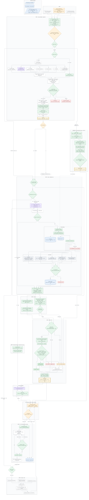

# Data Designer

> **Every claim a counterparty makes, checked before you sign.**
> ContextCon 05 · BITS Pilani · "Services, Replaced" · Tracks: **Trust & compliance + Investing** (also answers Research & markets questions)
> *Draft README. Phase 3 replaces every `‹…›` with measured values from `reports/`.*



---

## The service

**The job and who pays for it today.** A mid-size Indian 3PL pays three groups to decide whom to trust and what to buy:
- compliance teams and background-verification agencies, to clear vendors and carriers;
- diligence firms and M&A advisors, to find and check acquisition targets and partners;
- research analysts, to answer market questions.

Analysts spend days per counterparty.

**Input:** a typed request or a counterparty pack.
- Lists: "Find ten Indian B2B software companies founded since 2023 whose team grew by half in the last six months…"
- Questions: "Which Indian fintech companies are hiring the most engineers this quarter…?"
- Mandates: "acquirable logistic companies in maharashtra".
- Packs: a deck or onboarding documents.

**Finished result:** an **Information Memo**:
- **Research Memo:** answer box, a table where every cell is classed and sourced, labelled inferences.
- **Market IM:** a shortlist scored on a fixed rubric.
- **Company IM:** the suggestion (PURSUE / CLEAR … / HOLD / PASS / REJECT), the scorecard shown first, leadership fit, regional fit, and the conditions that would change it.

Emails to counterparties go out only after a person approves them, exactly once.

**Pass mark:**
- ≥ 90% verdict accuracy on the hidden cases;
- **zero** wrong VERIFIED/FALSE;
- 100% of facts sourced, or NOT VERIFIABLE with what is missing;
- every action exactly once after a kill;
- each run inside its cost and time limits.

## What it does now

‹tick from PROGRESS.md›
- Query reasoning card
- Research Memos
- Scouting (7 streams)
- Deck fact-check (7 verdict classes)
- Financial analysis (metric dictionary, A–E grade)
- Leadership fit
- Regional fit
- R1/R2/R3 rubrics
- Approval console
- Exactly-once mail
- Re-check

## What comes next

‹P2 items›
- Watchers for continuous monitoring
- Licensed registry APIs (MCA/GST/EPFO) replacing operator extracts
- OpenSanctions licence
- Batch endpoints for 100× volume
- Multi-tenant config for a second client

## How it runs

```bash
make setup-secrets        # hidden input: Claude API key, Gmail address + app password, test inbox → .env (never committed)
make setup                # deps + pre-commit secret scan
make smoke                # Crustdata, Claude (models + structured output) and Gmail (SMTP + IMAP) checks (≈0 credits)
docker run -d -p 8025:8025 -p 1025:1025 axllent/mailpit   # local inbox for automated tests
make run                  # http://localhost:8000 (dark console; reference look in ui/prototype/, `make ui-proto`)
make test backtest e2e    # replay mode — no credits
make kill-demo            # exactly-once demo
```

## What we tried

‹ablations with numbers›
- LLM-only verdicts vs deterministic rules (wrong VERIFIED/FALSE count).
- With vs without quote lock.
- Media allow-list vs any news.
- Raw vs deduped job postings.

## Why this way

- **Deterministic rules decide.** Claude only reads and writes (structured outputs, quoted evidence), so a wrong answer can't come from a model's guess.
- **Facts are quote-locked**, so every fact links to the exact passage or field and its date.
- **Source tiers** put public records above reliable media, then licensed data, then counterparty documents, then self-published material.
- **The rubric is fixed and versioned,** and its scorecard is shown before any suggestion.
- **Journal-before-send** makes actions exactly once.
- **Config-first** design makes requirement changes and live fixes minutes of work.

## Data sources called

| Source | Used for | Tier |
|---|---|---|
| Crustdata `company/search`, `company/search/autocomplete`, `company/identify`, `company/enrich` | discovery, identity, headcount and growth, founders, funding, competitors | T2 |
| Crustdata `person/search`, `person/enrich` (+ live) | founders' and leaders' history, people located in a region | T2 |
| Crustdata `job/search` (+ aggregations) | hiring rankings, themes, expansion signals | T2 |
| Crustdata `web/search/live`, `web/enrich/live` | reliable-media evidence (allow-list), pages for quote lock | T1-M / T4 |
| MCA21 master data, GST search by PAN, EPFO establishment search, VAHAN (operator extracts; no captcha bypass) | identity, status, footprint, headcount lower bound, fleet registration | T1 |
| Internet Archive (Wayback CDX) | earliest evidence, "founded since" cross-check | T1 |
| Counterparty documents (decks, audited statements, lease deeds, RC copies) | claims and financial analysis | T3 |
| Claude API (`anthropic` SDK: Haiku for classification, Sonnet for reasoning and extraction, Opus for offline adversarial tests) | query reasoning, extraction, classification with quoted evidence, prose under number lock (never decides) | — |
| Gmail SMTP + IMAP (app password) | approved outreach emails, sent exactly once and reconciled against the Sent folder | — |

## Cost per job

‹from reports/cost_per_job.md: measured credits (X-Credits-Used) + Claude tokens (usage, incl. cache reads) → ₹, per family›

## Ethics and personal data

- **Purpose-limited person checks:** directors and CXOs only.
- **No personal contact data,** and **no protected attributes** in leadership fit.
- **No auto-confirmation:** namesakes are never auto-confirmed and person findings never auto-reject.
- **No captcha bypass.**
- **DPDP-aligned retention.**
- **A person approves** every email and every Reject.

Details: [docs/ARCHITECTURE.md §20](docs/ARCHITECTURE.md).

## Repo map

`docs/` holds the specs:
- ARCHITECTURE, STANDARDS, RUBRIC, AGENTS, TEST_PLAN, WORKFLOW, WALKTHROUGH, UI_THEME, COMPETITION_BRIEF;
- diagrams.

The rest:
- `config/`: every rule, threshold and term;
- `datadesigner/`: the app;
- `verification/`: back-test agents;
- `tests/`: cases and cassettes;
- `tools/`: scripts.
