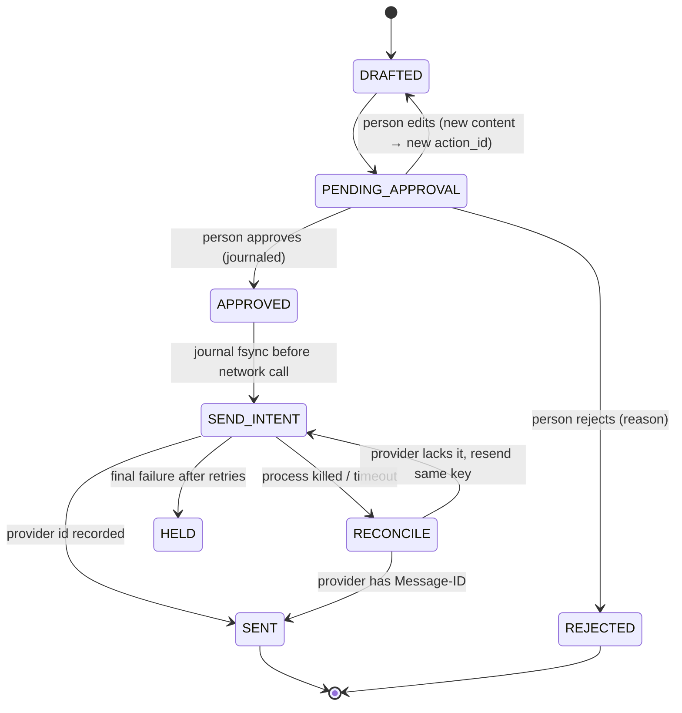

# Data Designer — System Architecture (v7)

> Every claim a counterparty makes, checked before you sign.
> ContextCon 05 · BITS Pilani · "Services, Replaced" · Tracks: **Trust and compliance + Investing**

Companion docs: **[`IMPLEMENTATION_PLAN.md`](../IMPLEMENTATION_PLAN.md)** (build plan for Claude Code) · **[`AGENTS.md`](./AGENTS.md)** (runtime + verification agents) · **[`RUBRIC.md`](./RUBRIC.md)** · **[`TEST_PLAN.md`](./TEST_PLAN.md)** · **[`WORKFLOW.md`](./WORKFLOW.md)** · **[`UI_THEME.md`](./UI_THEME.md)** · **[`COMPETITION_BRIEF.md`](./COMPETITION_BRIEF.md)** · **[`STANDARDS.md`](./STANDARDS.md)** (verdict classes, metric dictionary, rubrics, Information Memo format: the single source of truth) · **[`WALKTHROUGH.md`](./WALKTHROUGH.md)** (one query, "acquirable logistic companies in maharashtra", from input to final memo).
Full system flowchart: [`architecture.mmd`](./diagrams/architecture.mmd) (source; GitHub renders it, or paste into mermaid.live) · rendered: [`architecture.png`](./diagrams/architecture.png) / [`architecture.svg`](./diagrams/architecture.svg).
Legend: purple = LLM step · green = deterministic rule/code · orange = person in the loop · blue = store · grey = live source · red = stop/negative.
**v7 changes:** the LLM is the **Claude API** (roles and models in `config/llm.yaml`; structured outputs; never decides); outbound email goes through **Gmail SMTP** with an app password and is reconciled over IMAP (`config/mail.yaml`); the console uses the dark theme sampled from crustdata.com (`ui/prototype/`). The build is organised in **3 phases** (IMPLEMENTATION_PLAN.md). The layout block in §25 is the logical module map; the physical repo layout is in IMPLEMENTATION_PLAN §3.1B.

---

## 0. One-page summary

| | |
|---|---|
| **Job replaced** | Counterparty diligence for a mid-size Indian 3PL: vendor/carrier clearance (compliance team), JV-partner checks, and acquisition-target sourcing + diligence (strategy/CFO office, M&A advisors). Analysts spend days per counterparty today. |
| **Who pays today** | The client pays compliance staff, background-verification agencies, diligence firms and M&A advisors per counterparty or per mandate. |
| **Input** | **Research questions and list requests** ("Which Indian fintechs are hiring the most engineers this quarter…?", "Find ten Indian B2B software companies founded since 2023…") are answered directly as Research Memos (§3, STANDARDS §6.8/§7.5). For diligence, **Step 1 is always a mandate**, typed as a query ("acquirable logistic companies in maharashtra") or filled in as a form, and confirmed by you: your hard and soft constraints (industry, location, revenue, ARR, EBITDA margin, tech stack, headcount, growth, years operating, funding, exclusions). Optionally a named company (vendor, banker intro) and its pack (teaser, deck, onboarding form, financial statements, website URL). |
| **Finished result** | An **Information Memo** (STANDARDS §6). **Market IM** after Step 1: market view, funnel, shortlist scored on R1 with the reasons, and which companies to pursue. **Company IM** after Step 4: suggestion box (label, score range, coverage, rule, 3 reasons for and against, conditions, what would change it), R2 scorecard, company snapshot, market & competition, financial analysis on standard metrics, every claim binned into 7 verdict classes (✅ verified · 🟢 partially verified · 🟡 unverified · ⏳ outdated · ⚪ not verifiable · ❌ false · ⚫ not checked), people, risks, next steps and dated sources. You decide; approved emails are sent exactly once; re-checks update the IM. |
| **Pass mark** | ≥ 90% verdict accuracy on hidden cases; **zero** wrong ✅ VERIFIED/❌ FALSE; 100% of facts sourced or ⚪ NOT VERIFIABLE + what is missing; every action exactly once after a kill; run stays inside cost and time limits. |
| **Core principle** | The LLM *reads and writes prose*. It never decides a verdict, a number, a score or a grade. Rules, formulas, a fixed versioned rubric and quote-locked evidence do, and the scorecard is shown before any suggestion. |

---

## 1. Gaps fixed from v1

| Gap (v1) | Fix (v2) | Section |
|---|---|---|
| No sourcing depth: sourcing was a one-liner | **Sourcing & market-intelligence engine** with 7 verifiable input streams (incl. people and jobs located in the target state), signal scoring on employee composition, leadership trends, growth, competition, market size and PMF | §6 |
| Financial statements not verified | **Financial statement verification**: 25 integrity, cross-registry and red-flag checks (FSV-xx) | §12 |
| No financial analysis | **Financial research engine**: standard ratio library, Altman Z″, Beneish M, Piotroski F, peer benchmarks, A–E grade, per-metric drill-down, "ask the analyst" | §13 |
| Person checks were thin | **People background check**: identity resolution, role/tenure verification, directorship network, sanctions/PEP/debarment, adverse media, namesake clearing, leadership churn | §14 |
| Email was a single box | **Mail connector engine**: templates bound to verified facts, policy guard, approval queue, journaled exactly-once executor, provider adapters, inbound replies → re-check | §17 |
| Human step not designed | **Approval console**: one-screen decision card, red flags, drill-downs, approve/edit/reject with reasons | §16 |
| **Finance (25 pts)** not addressed | Buyer, ₹ pricing, measured cost per job from the ledger, unit economics | §21 |
| **Ethics (25 pts)** only "redact logs" | DPDP-aligned data handling, namesake protection, no auto-reject on people, explainable decision trace, outreach ethics | §20 |
| **Live fix (5 min)** not designed for | Config-first: schema, rules, metrics, thresholds, templates, limits in YAML with hot reload + golden tests in < 30 s | §23 |
| Intake parsed the pack first, but a target has no pack until it is sourced and contacted | **Step 1 is always Scout & finalise** against your constraints (discovery or fit-check mode). Document intake moves into M4 and runs only once a pack exists | §2, §3, §5, §8 |
| Any news counted the same | **Reliable-media tier (T1-M)**: allow-listed outlets' own reporting verifies events; press releases and brand content count as self-published | §4.1, STANDARDS §3 |
| Location was only a constraint | **Region of operation is scored**: regions of operation (RG-01), target-region share, network fit → regional fit in R1 (S8) and R2 (C10) | STANDARDS §4.3 |
| Query words were matched, not reasoned | **Query reasoning**: each word → intent → parameters → metrics → thresholds → role; "acquirable" implies strong ratios, sound tech, a fit team and clean governance as min-band requirements | §5.0, STANDARDS §5 |
| Deck bios were only verified, not judged | **Leadership fit** (LF-01…07) from the deck and records → FIT / FIT WITH GAPS / WEAK FIT / NOT FIT, in the verdict (R2 C9, gate G8) | §14 P9, STANDARDS §4.7 |
| Tech claims were not scored | **Tech soundness** (TC-01/02) → R1 S9, R2 C11 | STANDARDS §4.6 |
| Verdicts were 10 loose labels | **7 standard verdict classes** with reason codes, credits and a first-match procedure | STANDARDS §2, §11 |
| Output was a report JSON | **Information Memo**: Market IM (Step 1) and Company IM (Step 4) with fixed sections, sentence templates and writing rules | STANDARDS §7, §15.4 |
| Metrics had loose bands | **Metric dictionary**: IDs, formulas, sources, freshness, fixed 0–4 bands, health-grade formula | STANDARDS §4 |
| HQ-only location search missed firms run from another state | Location **basis** (operates / primary_ops / hq), GST-by-PAN footprint check, people- and jobs-in-state streams | §5.5, §6.1 |
| "Acquirable" undefined | Defined **AQ bundle** (ownership, status, size, founder-led, cap table) + "worth buying" requirements via query reasoning | §5.6, STANDARDS §4.8, §5.2 |
| Constraints were a loose "thesis" | **Constraint catalogue** (ARR, revenue, location, tech, industry, …) mapped to data fields and tiers, hard/soft, with pass / fail / likely fail / unknown rules | §5 |
| Verdict logic was rule IDs without a score | **Constant, measurable rubrics**: R1 (scouting) and R2 (decision) with gates, 0–4 bands on absolute thresholds, fixed weights, floor–ceiling score, coverage, fixed threshold rule, "what would change it" | §15 |
| Suggestion could appear without its reasoning | Console order is fixed: gates → scorecard → result → suggestion → your decision | §16 |
| 3 evidence tiers | 4 tiers (adds licensed data providers between public records and counterparty documents) | §4 |
| Registry captchas ignored | No captcha bypass. Fallback to licensed APIs or operator-retrieved extracts; otherwise ⚪ NOT VERIFIABLE | §4, §9 |

---

## 2. System at a glance

Every flow starts with **Step 1 · Scout and finalise**. You set the constraints (industry, location, revenue, ARR, tech, headcount, growth and so on). The system finds companies that fit, or tests a company you name against the same constraints, and scores each one on a fixed rubric. Nothing is checked in depth until you finalise the company.

```
STEP 1 · SCOUT & FINALISE  (always first)
  Query or mandate form ─► M1 parse → draft mandate → you confirm (location basis, size, listed?)
  └► M2 Scouting engine
       ├ discovery mode: no company named → 6 search streams → candidates
       └ fit-check mode: company named (vendor, banker intro) → same constraints
     ─► constraint gate: pass / fail / unknown per constraint, each with a source
     ─► R1 Scouting rubric: fixed, versioned, 0–100 as floor–ceiling + coverage
     ─► shortlist with scorecards ─► MARKET IM ─► person finalises
STEP 2 · SCREEN & REACH OUT  (finalised target with no pack yet)
     M3 Entity resolution · public-data signals · M10 light · red flags
     ─► teaser/info-request email ─► M12 approve ─► M13 send ─► wait for pack
STEP 3 · CHECK  (pack on hand: vendor at once, target after it replies)
     M3 Entity resolution · M4 Document intake + claim extraction · M5 Evidence collection
     M6 Quote lock · M7 Verdict engine · M8 Statement verification
     M9 Financial research engine · M10 People background check
STEP 4 · DECIDE
     M11 gates ─► R2 Decision rubric ─► floor–ceiling score ─► fixed threshold rule
     ─► scorecard + explanation shown FIRST ─► COMPANY IM (suggestion) ─► M12 person decides
STEP 5 · ACT        M13 Mail engine (approved, exactly once)
STEP 6 · RE-CHECK   M14 snapshot → re-run M5–M11 → re-score R2 → diff
Cross-cutting: Source gateway · Evidence ledger · Evidence cache · Cost ledger · Action journal · Config · Logs
```

| # | Module | Deterministic? | LLM role |
|---|---|---|---|
| M1 | Mandate & constraints (+ routing) | yes | optional: turn a free-text brief into a draft constraint form that you confirm |
| M2 | Scouting & finalisation engine | gate + scoring: yes | extract company names from news; summarise |
| M3 | Entity resolution | yes | none |
| M4 | Document intake + claim extraction | parsing: yes | extract claims + exact spans (schema-constrained) |
| M5 | Evidence collection | yes | propose search queries only |
| M6 | Quote lock | yes | propose candidate passages only |
| M7 | Verdict engine | yes | none |
| M8 | Financial statement verification | yes | table → JSON parsing assist (validated by footing checks) |
| M9 | Financial research engine | yes | analyst note from computed numbers (number-locked) |
| M10 | People background check | yes | none for verdicts; summarise |
| M11 | Gates + rubrics + decision | yes | none in scoring; explanation is a fixed template |
| M12 | Approval console | — | none |
| M13 | Mail engine | send path: yes | polish tone of templates (fact-locked) |
| M14 | Re-check | yes | none |
| M15 | Research Analyst (list and question answers) | criteria checks + ranking: yes | B2B/fintech classification with quoted evidence; hiring-theme clustering → Inference Strength rule |

LLM provider: the **Claude API** via the `anthropic` SDK: structured outputs (JSON schema validated by Pydantic), roles `classify` (Haiku), `reason` (Sonnet), `adversarial` (Opus, offline) and `judge` (Sonnet) from `config/llm.yaml`, models discovered with `models.list()` at startup, every response cached for replay. Each module is implemented by a runtime agent (A0–A15) with a verification agent (V1–V8): see [AGENTS.md](./AGENTS.md).

---

## 3. Flows and run types

**Order of work by flow.** Step 1 always comes first; only its mode changes.

| Flow | Who | Step 1 mode | Then |
|---|---|---|---|
| **New target (Investing)** | Strategy / CFO office | discovery: constraints → search → shortlist | Screen → outreach → pack arrives → Check → Decide → Re-check |
| **Named target** (banker or client intro) | Strategy / CFO office | fit-check: named company vs constraints | same as above |
| **Vendor / carrier / partner (Trust and compliance)** | Procurement / compliance | fit-check against vendor constraints (serviceable states, fleet size, GST active, years operating, …) | Check (pack already on hand) → Decide |

**Run types**

| Type | Trigger | Stages | Output |
|---|---|---|---|
| `SCOUT` | Query or mandate form, optionally with a named company | M1 → M2 → constraint gate → R1 → Market IM → person finalises | **Market IM**: shortlist with R1 scorecards, excluded list with reasons, market view |
| `SCREEN` | Finalised target with no pack | M3 → M2 signals → M10 (light) → red flags → M12 → M13 | Public-data screen + approved intro/teaser-request email; run waits in `AWAITING_PACK` |
| `CHECK` | Pack on hand (vendor) or received by reply (target) | M3 → M4 → M5 → M6 → M7 → M8 → M9 → M10 → M11 (gates + R2) → M12 → M13 | **Company IM**: claim register by verdict class, health report, R2 scorecard, explained decision, request list |
| `RESEARCH` (FIND_LIST / RESEARCH_QA) | A question or list request | M1 reasoning → M15 plan → M2 search streams → M5–M7 per row attribute and criterion → M15 ranking + inferences → R3 → Research Memo | **Research Memo**: answer box, table with classes, inferences with strength, near-misses, premise checks |
| `RECHECK` | Before the next meeting, a watcher webhook, or extra documents after a decision | M14 → M5–M11 on changed inputs → R2 re-scored | Diff since last snapshot, including score movement |

All runs for one company share a `counterparty_id`. Evidence gathered while scouting and screening is reused from the cache, so the check never pays for it twice.

Run state is checkpointed after every stage (`runs/{run_id}/stage_N.json`). A restart resumes from the last completed stage.

---

## 4. Verifiable input streams (source registry)

All sources live in `config/sources.yaml` (tier, cost, rate limit, staleness window, fallback). Crustdata base URL `https://api.crustdata.com`, headers `authorization: Bearer <key>`, `x-api-version: 2025-11-01`.

### 4.1 Evidence tiers

| Tier | Kind | Examples | Can produce ✅ VERIFIED? |
|---|---|---|---|
| **T1** | Independent public records | MCA21 master data / filings, GST taxpayer search, EPFO establishment search, stock-exchange filings, sanctions/debarment lists, courts | Yes |
| **T1-M** | **Reliable media**: allow-listed outlets (`media.yaml`), own reporting only; press releases and sponsored/brand content excluded (= T4) | Wire services, national business dailies (tier A); national dailies and trade press on the list (tier B) | Yes for events, appointments, deals, contracts and facilities (V5: one tier-A or two independent tier-B reports); financial figures only if the article cites filings. Rules: STANDARDS §3 |
| **T2** | Licensed data providers (independent, derived) | Crustdata company/person/job data, web traffic, reviews | Only 🟢 PARTIALLY VERIFIED (lower bound or estimate band) or identity fields; never sole basis for financial ✅ VERIFIED |
| **T3** | Counterparty-provided documents | Audited statements, EPFO challans, lease deeds, customer contracts | 🟡 UNVERIFIED unless matched to T1 |
| **T4** | Self-published | Website, press releases, deck | 🟡 UNVERIFIED |

### 4.2 Crustdata endpoints used

| Use | Endpoint | Key fields | List price* | Rate limit* |
|---|---|---|---|---|
| Resolve entity | `POST /company/identify` (≤ 25 identifiers, one type per call) | name, domain, profile URL, id → ranked `matches[]` with `confidence_score` | 0.2 per matched identifier (identify docs; the pricing page says free, so the ledger uses `X-Credits-Used`) | 30 RPM |
| Discover exact filter values | `POST /company/search/autocomplete` `{field, query, limit≤100}` | `suggestions[].value` for industries, categories, country, funding types | — | 300 RPM |
| Company profile | `POST /company/enrich` (≤25 ids) | `basic_info`, `headcount{total, by_role_percent, by_region_absolute, growth_percent{mom,qoq,six_months,yoy,two_years}}`, `people{founders, decision_makers, cxos}`, `funding`, `hiring{openings_count, openings_growth_percent, recent_openings}`, `revenue.estimated{lower,upper}_bound_usd`, `competitors`, `news`, `web_traffic`, `employee_reviews`, `locations`, `taxonomy`, `updated_at`, `indexed_at` | 2 credits base | 15 RPM |
| Sourcing / market map | `POST /company/search` | filters on `taxonomy.*`, `locations.country`, `headcount.total`, `headcount.growth_percent`, `funding.*`, `revenue.estimated.*`, `competitors.*` | 0.03/result (+0.2 headcount group) | 30 RPM |
| People at company | `POST /person/search` | current/past employer, title, seniority | 0.03/result (+0.1 experience) | 30 RPM |
| Person profile | `POST /person/enrich` (≤25 URLs, cached) / `POST /person/professional_network/enrich/live` (fresh) | `experience.employment_details.current[]/past[]`, `education.schools[]`, `updated_at` | 1 credit base | 15 / 10 RPM |
| Outreach contact | `POST /person/contact/enrich` | **business email only** (policy) | 1 per business email | 15 RPM |
| Hiring signal / research | `POST /job/search` | filters on `job_details.category` (Engineering…), `metadata.date_added`, `company.locations.country`, `company.basic_info.industries`; `aggregations: group_by company.basic_info.company_id` with `limit: 0` | 0.03/result | 30 RPM |
| Web/news search | `POST /web/search/live` | `sources: [web, news, ai]`, `site`, `start_date`, `end_date` | 1/query | 10 RPM |
| Web fetch | `POST /web/enrich/live` (≤10 URLs) | `content` (HTML), `timestamp` | 1/page | 10 RPM |
| Monitoring | `POST /watch/company/search`, `/watch/person/search` (discovery); company/person entity watches | change webhooks | 2/new company; 5/changed entity | 10 RPM/path |
| Cost truth | `X-Credits-Used` response header; `GET /account/usage/events`; `GET /account/endpoints` (free) | per-call cost reconciliation | — | — |

*List prices and default limits from Crustdata docs; the account's real prices come from `GET /account/endpoints` at startup.

### 4.3 Indian public records and other sources

| Source | What it proves | Access reality | Fallback chain |
|---|---|---|---|
| **MCA21 V3 master data** | Legal name, CIN, status, incorporation date, registered office, authorised/paid-up capital, directors/signatories, index of charges | Free public view; captcha. Filed documents (AOC-4 financials, MGT-7) cost ₹100 per company and need a login | Crustdata web fetch of the public page → licensed registry API → **operator-retrieved extract** (person uploads PDF; hashed, dated, tier T1-operator) → ⚪ NOT VERIFIABLE |
| **MCA director master data / DIN** | Director identity, other directorships, disqualification | as above | as above |
| **GST Search Taxpayer** | Legal/trade name, status (active/cancelled), registration date, constitution, principal place of business, return-filing status | Public pre-login search; captcha | Licensed GSP taxpayer API → operator extract → ⚪ NOT VERIFIABLE |
| **EPFO establishment search** | Establishment exists; covered employees (lower bound); remittance regularity | Public portal | Counterparty EPFO challans (T3) → ⚪ NOT VERIFIABLE |
| **BSE/NSE filings** | Audited results, annual reports of listed peers and targets | Public | Crustdata web fetch → direct fetch |
| **OpenSanctions `/match`** | Sanctions, PEP, debarment (incl. NSE debarred entities, OFAC/UN/EU) | API key; licence needed for commercial use | Official list files (UN, OFAC) cached daily → ⚪ NOT VERIFIABLE — source unavailable |
| **SEBI orders, IBBI, NCLT, eCourts** (P2) | Debarment, insolvency, litigation | Public | `not checked` (declared, not hidden) |
| **Internet Archive (Wayback CDX)** | Earliest evidence for "operating since …", deleted claims | Public | ⚪ NOT VERIFIABLE |
| **Reliable media (T1-M)** | Events, appointments, contracts, facility openings, confirmed adverse items | Crustdata `web/search/live` (news) filtered to the `media.yaml` allow-list; own-reporting and near-duplicate tests (STANDARDS §3.2) | other allow-listed outlet → GDELT for leads only (tier C, never evidence) |
| **VAHAN (vehicle registry)** | Registration state and owner of sampled fleet RC numbers | Public lookup; captcha → operator extract | `NOT VERIFIABLE` for unsampled vehicles |
| **Client records (kickoff kit)** | Carrier records, rules, prices | Provided | — |

**No captcha bypass, and no scraping against a site's terms.** A blocked source gives ⚪ NOT VERIFIABLE — source unavailable plus the name of the document that would settle the claim.

---

## 5. M1 — Mandate & constraints (Step 1, always first)

You start every job with a **mandate**: type a query or fill in the form (UI or `mandate.yaml`). Each constraint is either **hard** (a must-have, so a failure excludes the company) or **soft** (a preference with a weight that feeds R1 criterion S1).

### 5.0 From a typed query to a mandate

You can type a query ("acquirable logistic companies in maharashtra") instead of filling the form. The query is **reasoned over, not keyword-matched**. Each word is mapped through the term library (`terms.yaml`) to its intent, the parameters that intent implies, the metric IDs that measure them, a threshold and a role: search filter, hard constraint, soft constraint, or **minimum-band requirement** on an existing rubric criterion. For example, "acquirable" means both *can be bought* (AQ-01…06) and *worth buying*: strong financial ratios (health ≥ B, solvency ≥ 3, cash quality ≥ 2), sound tech claims (TC-C ≥ 2), leadership fit ≥ FIT WITH GAPS, and clean governance. Requirements never change rubric weights; an unmet one caps the label one level (STANDARDS §5). The LLM proposes the mapping from the library; anything outside it is shown as "proposed — confirm". It never invents a number. Defaults come from config or the client profile. Every line of the draft is tagged `from query`, `default` or `assumed — confirm`, and a confirmation screen asks at most three questions: location basis, size range, listed companies in or out. Example: [WALKTHROUGH §1](./WALKTHROUGH.md#1-input-what-you-type-and-what-data-designer-shows-back).

### 5.1 Constraint catalogue (`config/mandate.yaml`)

| Constraint | Example | Measured from (best tier first) | When the data is weak |
|---|---|---|---|
| Industry / sub-sector | warehousing, cold chain, freight forwarding, 3PL | MCA NIC code (T1) > `taxonomy.professional_network_industry`, NAICS/SIC (T2) | — |
| Location (with **basis**: operates / primary_ops / hq, §5.5) | "in Maharashtra" | GSTIN state code via GST search by PAN (T1) > office addresses, employees located in state, openings in state (T2) > website (T4); HQ from MCA registered office (T1) | one weak signal only = `unknown` |
| Revenue (₹) | ₹50–500 crore | filed statements (T1) > provided statements (T3) > `revenue.estimated` band in USD, converted at a dated FX rate (T2) | an estimate band that straddles the range = `unknown` |
| ARR (₹) | ≥ ₹20 crore | only for subscription or contract revenue: provided ARR/MRR schedule or contracts (T3) > deck claim (T4) | no public source exists for private firms, so `unknown` at Step 1; confirmed at `CHECK` |
| EBITDA margin | ≥ 8% | filed (T1) or provided (T3) statements | usually `unknown` at Step 1 |
| Headcount | 100–800 | EPFO covered members (T1, lower bound) > `headcount.total` (T2, lower bound) | — |
| Headcount growth | YoY ≥ 15% | `headcount.growth_percent` (T2) | — |
| Tech stack | runs a WMS/TMS; offers API integration | `technographics` (T2; needs permission, +2 credits) > job posts naming the tools (`job/search`) > website text (T4) | a job post proves "hiring for", not "uses in production" |
| Years operating | ≥ 5 | MCA incorporation date (T1) > `basic_info.year_founded` (T2) | — |
| Funding / ownership | bootstrapped or ≤ Series B; private limited | MCA company class (T1) > `funding.*` (T2) | — |
| Customers / segments | serves e-commerce or FMCG | customer-side public statement (T1/T4) | soft only |
| Certifications / registrations | ISO 9001; warehouse registration (e.g. WDRA) | issuer or registry page (T1) | soft only |
| Exclusions | the client's competitors, existing vendors, named groups | client list | always hard |

Adding a constraint means adding one entry with its field mapping and operator. No code change is needed.

### 5.2 How a constraint is evaluated

| Result | Rule |
|---|---|
| **Pass** | Evidence satisfies the operator. A T2 estimate band lying fully inside the range passes, tagged `estimate`. |
| **Fail** | T1 or T3 evidence breaks the constraint. The company is excluded, and the excluded list shows the reason and the source. |
| **Likely fail** | Only a T2 estimate breaks it (e.g. the revenue band sits fully outside the range). The company is excluded from the shortlist but listed under **"Excluded on estimates"**, so you can bring it back with one click. |
| **Unknown** | No evidence, or the band straddles the limit. The company stays in, flagged "confirm at CHECK". In R1 the constraint scores 0 in the floor and full marks in the ceiling (STANDARDS §6.2). |

### 5.3 Compiling constraints into searches

Hard constraints that map to Crustdata search fields are pushed into the `company/search` filter, so you don't pay to enrich companies that would fail anyway. The rest are evaluated after enrichment.

```json
{"filters":{"op":"and","conditions":[
  {"field":"taxonomy.professional_network_industry","type":"in","value":["Transportation, Logistics, Supply Chain and Storage","Warehousing and Storage"]},
  {"field":"locations.country","type":"in","value":["India"]},
  {"field":"headcount.total","type":">","value":100},
  {"field":"headcount.total","type":"<","value":800}]},
 "fields":["crustdata_company_id","basic_info.name","basic_info.primary_domain","headcount.total","locations.state"],
 "limit":100}
```

Industry values come from `/company/search/autocomplete`, so the filter uses Crustdata's own labels.

### 5.4 Routing after Step 1

- **Finalised + no pack → `SCREEN`.** **Finalised + pack attached → `CHECK`.** Existing counterparty with a prior decision → `RECHECK`.
- **Join, don't duplicate:** if a run for the same company is already in flight (matched by domain, CIN or `crustdata_company_id`), the request attaches to it.
- **Inbound documents:** a reply on a run in `AWAITING_PACK` starts `CHECK`. A reply after a decision goes to `RECHECK`.

### 5.5 Location: what "in Maharashtra" means

A natural-language location is ambiguous, so the mandate stores a **basis**, which you confirm on screen:

| Basis | Passes when | Use it for |
|---|---|---|
| `operates` (default) | FP-01 = Yes: a GSTIN with the state's code (27 = Maharashtra) **or** ≥ 2 of: an office/warehouse address in the state · ≥ 10 employees located there · ≥ 3 openings there in 90 days | "companies in Maharashtra" |
| `primary_ops` | FP-02 footprint share ≥ the threshold (default 40%) | "Maharashtra-focused companies" |
| `hq` | Registered office in the state (MCA master data; the CIN's state code is the state at incorporation, so it is only a fallback) | "Maharashtra-headquartered companies" |

**Discovery does not filter on HQ alone.** Besides the HQ-in-state company search, two streams find out-of-state operators: people located within 60 km of the state's logistics cities, grouped by employer (`person/search` with `geo_distance`), and job openings in those cities grouped by company (`job/search`). A company headquartered in Delhi that runs most of its operations and fleet from Mumbai is therefore **found and passes** under `operates` and `primary_ops`. It fails only under `hq`, where it is listed with the reason "registered office Delhi" and can be restored by switching the basis. Fleet location is settled at CHECK from RC copies (registration state, sample-checked against VAHAN) and an e-way-bill summary by origin state. Worked case: [WALKTHROUGH §2.3](./WALKTHROUGH.md#23-your-question-hq-in-delhi-operating-in-mumbai-most-of-the-fleet-in-mumbai--does-it-show-up).

**GST trick:** a GSTIN is the 2-digit state code + the 10-character PAN, so one GSTIN found on a website or invoice gives the PAN. A GST search by PAN then lists every state registration, active or cancelled. This is a T1 footprint check that costs no credits.

### 5.6 "Acquirable" and other compound words

Compound terms expand to **defined constraint bundles** in `mandate.yaml`, so the same word always means the same thing. "Acquirable" → **can be bought**: AQ-01…AQ-06 (private/LLP · not acquired or a subsidiary · active and not insolvent · revenue within buyer capacity · founder-led · no institutional round in 24 months; STANDARDS §4.8) **and worth buying**: minimum-band requirements for strong financial ratios, sound tech claims, leadership fit and clean governance (STANDARDS §5.2). It does not claim the owners want to sell; only outreach answers that.

---

## 6. M2 — Scouting & finalisation engine

**Two modes, one gate and one rubric.** In *discovery mode* (no company named) it runs the streams below. In *fit-check mode* (a vendor or an introduced target) it resolves the named company and runs the same constraint gate and R1 rubric. Either way you see the same scorecard.

### 6.1 Input streams (discovery mode; seven streams A–G)

| Stream | Source | Purpose | Dedup key |
|---|---|---|---|
| A. Structured search | `company/search`: hard constraints compiled to filters (§5.3): industry, `locations.state` (HQ in state), headcount band, growth, funding | Firms headquartered in the target state | `crustdata_company_id` |
| G. People in state | `person/search`: `geo_distance` around the state's logistics cities · current employer industry ∈ set → group by employer, keep ≥ 10 people | **Firms headquartered elsewhere that operate in the state** (§5.5) | company name → `company/identify` |
| B. Event-driven news | `web/search/live` news restricted to the reliable-media allow-list (press releases and brand content set aside as self-published), date window (last 90 days): "raises", "acquires", "new warehouse", "expands to" → LLM extracts names → `company/identify` (free) | Momentum and deal signals | domain |
| C. Hiring signal | `job/search`: ops/warehouse/fleet roles in the target state's cities, last 90 days, grouped by company | Expansion proxy; also catches out-of-state operators | company id |
| D. Registry | MCA new registrations / NIC 52xx (warehousing & support for transport) where fetchable | New entrants, competition density | CIN |
| E. Continuous | `watch/company/search` discovery watcher with the mandate filters | New matches without re-running | company id |
| F. Client lists | Kickoff-kit records, banker lists | Seed / exclude | domain / CIN |

Merge → dedup (id, domain, CIN, normalized name + city) → **lookalike guard** (names with fuzz ≥ 90 but different domain/CIN are kept apart and flagged) → enrich top N (budgeted) with `company/enrich` fields `[basic_info, headcount, people, funding, hiring, revenue, competitors, news, web_traffic, employee_reviews, taxonomy, locations]`.

### 6.2 Signals computed (each stored with evidence IDs)

| Dimension | Signals | Source |
|---|---|---|
| **Employee composition** | Function mix (`headcount.by_role_percent`: ops, sales, engineering, finance), region mix (`by_region_absolute`), seniority mix (sampled `person/search`, capped), EPFO covered members (lower bound) | T2, T1 |
| **Senior leadership trends** | CXO coverage (CEO/CFO/COO/CTO present?), median CXO tenure, CXO/VP departures in last 24 months (`person/search` on past employer + seniority), arrivals, founder still active, MCA director appointments/cessations | T2, T1 |
| **Growth** | Headcount growth mom/qoq/yoy/2y, hiring openings and growth, web-traffic trend, followers yoy, revenue-estimate band change | T2 |
| **Industry size & growth** | Market size and CAGR from cited reports (quote-locked); aggregate peer headcount growth as a sanity check | T4/T2 (labelled estimate) |
| **Competition** | Competitor set = `competitors` ∪ same-taxonomy search; per-competitor headcount, growth, funding, revenue band; target's growth percentile among peers; concentration (HHI on revenue-estimate midpoints, labelled estimate) | T2 |
| **Market sizing** | TAM top-down (cited); bottom-up = # buyer companies (counted via `company/search`) × spend per buyer (cited or client data); SAM = TAM × segment share (cited); SOM/market share = target revenue ÷ SAM | computed (labelled `estimate (method)`) |
| **Product-market fit (signals, not proof)** | Growth vs peer median, customer-facing hiring, verified customer logos, customer concentration (from statements' notes), employee-review trend, web-traffic trend, revenue growth vs headcount growth (operating leverage) | mixed |
| **Risk pre-screen** | Company name vs sanctions/debarment (possible matches only), adverse-news count | T1, T4 |

### 6.3 Scoring, recommendation and finalisation

1. **Constraint gate** (§5.2): fail → excluded list with reason and source; likely fail → "Excluded on estimates"; pass or unknown → scored.
2. **R1 Scouting rubric** (STANDARDS §6.3): fixed criteria S1–S9 (incl. leadership fit, regional fit, quality signals), 0–4 point bands with absolute thresholds, scored as a floor–ceiling range plus evidence coverage.
3. **Recommendation label** (fixed rule): **Recommend** if floor ≥ 60 and no risk flag · **Consider** if ceiling ≥ 60 · **Not recommended** if ceiling < 60.
4. **Shortlist** sorted by floor, then ceiling. Each row shows its scorecard before its label:

| # | Company (sample) | Hard constraints | R1 floor–ceiling | Coverage | Top reasons (sourced) | Label |
|---|---|---|---|---|---|---|
| 1 | Alpha Warehousing (sample) | 6/6 pass | 71–79 | 92% | headcount +34% YoY · CFO and COO in place · 3 named e-com customers | Recommend |
| 2 | Beta Cold Chain (sample) | 5/6 pass, ARR unknown | 52–80 | 71% | segment growth cited at 14% · revenue band straddles the limit | Consider |
| — | Gamma Freight (sample) | revenue band fully above ₹500 cr | — | — | excluded on estimate (Crustdata band, record date) | Excluded on estimates |

5. **You finalise.** The system never finalises on its own. Your choice and any override of a label are journaled with a reason.

### 6.4 Market-sizing rules

- A market figure is used only if the number, unit, year and publisher appear verbatim in the fetched page (quote lock).
- Currency and units are normalised (₹ crore/lakh ↔ USD bn) with a dated FX rate from config, and the conversion is shown.
- With several sources, show the range and median. If they disagree by more than 30%, flag `sources disagree`.
- Market figures are always shown as **third-party estimate (publisher, date)**, never ✅ VERIFIED.

---

## 7. M3 — Entity resolution

- Candidate keys: legal name, trade name, domain, CIN, GSTIN, city, year founded, LinkedIn URL.
- `company/identify` (free) → candidate ids; registry lookups give CIN/GSTIN when available.
- Match score = weighted agreement (domain 0.35, CIN/GSTIN 0.35, name fuzz 0.15, city 0.10, year 0.05).
- ≥ 0.85 → resolved; 0.60–0.85 → **HOLD (person picks from side-by-side candidates)**; < 0.60 → ⚪ NOT VERIFIABLE — entity not resolved.
- Lookalikes (e.g. "XYZ Logistics Pvt Ltd" vs "XYZ Logistic Solutions LLP") are never merged on name alone.

---

## 8. M4 — Document intake & claim extraction

Runs only once a pack exists: attached to a vendor request, or received as a reply to the outreach email. Before that, a target is screened on public data alone (`SCREEN`).

**Document intake**
- **Adapters:** kickoff-kit JSON, PDF (PyMuPDF + pdfplumber tables; OCR fallback for scans), PPTX (python-pptx), XLSX (openpyxl), URL (Crustdata web fetch), plain text, email attachments.
- Each page/slide is stored as raw text with `doc_id`, `page`, `sha256`. Spans cite `doc_id:page:char_start-char_end`.
- **Prompt-injection guard:** counterparty text is data. Extraction prompts wrap it; instructions found inside documents are ignored and logged.

**Claim extraction:** Claude (`reason` role) with a strict JSON schema (structured outputs), cached for replay. Every claim needs an exact span. Claims without a span are dropped.

```json
{"claim_id":"C-014","type":"headcount","subject":"company","text":"350+ employees across 6 states",
 "value":{"min":350,"unit":"employees"},"as_of":"2026-09","critical":true,
 "span":{"doc_id":"deck","page":4,"start":112,"end":142},"forward_looking":false}
```

Claim types (config): identity, incorporation_date, operating_since, registered_address, gst_status, headcount, locations/warehouse_count, fleet_size, revenue, ebitda, profit, growth_rate, funding, customer, certification, leadership_bio, award, market_size, projection, other. Forward-looking statements → `projection (not checked)`.

---

## 9. M5 — Evidence collection

- **Planner:** per claim type → ordered collector list (`config/collectors.yaml`). Critical claims are collected first. Each step carries an estimated cost (from the price table) that the budget guard checks before the call.
- **Collectors:** `registry` (MCA/GST/EPFO), `crustdata_company`, `crustdata_people`, `jobs`, `web` (search + fetch), `wayback`, `sanctions`, `exchange_filings`, `docs` (counterparty uploads).
- **Source gateway (single HTTP client):**
  - per-endpoint token bucket matching provider limits (Crustdata 30/15/10 RPM tiers);
  - retry with exponential backoff + jitter, honouring `X-RateLimit-Reset` / `Retry-After` on HTTP 429 `rate_limit_error`;
  - circuit breaker per source (open after 5 consecutive failures, half-open after 60 s);
  - fallback chains from `sources.yaml`;
  - total failure → ⚪ NOT VERIFIABLE — source unavailable (source, time).
- **Evidence cache:** key = `(source, normalized_request)` with a TTL per source (e.g. registry 7 d, Crustdata 3 d, news 1 d). Restarts and repeat counterparties cost nothing.
- **Budget & deadline guard:** per-run `max_credits`, `max_llm_tokens`, `deadline_s` (config). At 80% of budget, non-critical collection stops. Unchecked claims get ⚪ NOT VERIFIABLE — budget/deadline reached. The client can cut the budget mid-run (read on every call).

---

## 10. M6 — Quote lock

A fact enters the ledger only if its supporting passage or field **is present verbatim** in stored raw content.

- **Web/document:** the passage must match the raw fetched text after normalisation (NFKC, whitespace, Indian digit grouping `1,20,000` ↔ `120000`, `₹`/`Rs.`/`INR`, `cr`/`crore`). The match offset is stored.
- **API:** JSON path + value (`headcount.total = 412`) taken from the stored response body.
- Every evidence record stores: `source_url | api_endpoint`, `passage | field_path`, `record_date` (the record's own date: `updated_at`, filing date, article date), `retrieved_at`, `content_sha256`, `tier`.
- An LLM-proposed passage that fails the match is **dropped**, and the drop is logged.

---

## 11. M7 — Verdict engine (deterministic, `config/verdicts.yaml`)

Every claim gets **one of seven classes** with a reason code: ✅ VERIFIED · 🟢 PARTIALLY VERIFIED · 🟡 UNVERIFIED (SELF-REPORTED) · ⏳ OUTDATED · ⚪ NOT VERIFIABLE · ❌ FALSE · ⚫ NOT CHECKED. Definitions, reason codes, credits and the first-match classification procedure are in **[STANDARDS §2](./STANDARDS.md#2-verdict-classes)**. The rules below implement them:

| Rule | Condition | Class (code) |
|---|---|---|
| R-01 | T1 field equals claim within the type's tolerance | ✅ VERIFIED (V1) |
| R-02 | T1 field contradicts claim beyond tolerance, entity resolved | ❌ FALSE (F1) |
| R-03 | T1 lower bound (EPFO) ≥ claimed number | ✅ VERIFIED (V4) |
| R-04 | T2 lower bound (profiles) ≥ claimed number | 🟢 PARTIALLY VERIFIED (P1) |
| R-05 | Lower bound below the claim, no T1 count | 🟡 UNVERIFIED (U3) + "profiles show ≥ N"; **never** FALSE |
| R-06 | Claimed figure inside an independent estimate band | 🟢 PARTIALLY VERIFIED (P2) |
| R-07 | Compound claim, some parts verified | 🟢 PARTIALLY VERIFIED (P3) with the fraction |
| R-08 | "Since YEAR": earliest independent evidence ≤ YEAR | ✅ VERIFIED (V3); later → shown as "earliest evidence YEAR", FALSE only if T1 incorporation is later **and** no predecessor entity is found |
| R-09 | Figure equals filed statement (AOC-4/exchange) | ✅ VERIFIED (V2); equals only a provided statement → 🟡 UNVERIFIED (U1) |
| R-10 | Counterparty's higher-authority document contradicts its own lower-authority claim (audited FS vs deck) | ❌ FALSE (F2) |
| R-11 | Best evidence older than the metric's freshness window, or the claim presents a superseded figure | ⏳ OUTDATED (O1/O2) |
| R-12 | Only T3/T4 support | 🟡 UNVERIFIED (U1/U2) |
| R-13 | Independent sources conflict | ⚪ NOT VERIFIABLE (N3) → HOLD |
| R-14 | No source settles it / source down / budget / captcha / entity unresolved | ⚪ NOT VERIFIABLE (N1/N2/N5/N6/N4) + `missing: <document>` |
| R-15 | Forward-looking, opinion, out of scope | ⚫ NOT CHECKED (X1/X2/X3) |
| R-16 | Question premise contradicted / unsupported | ❌ FALSE (F3) / ⚪ NOT VERIFIABLE (N7) |
| R-17 | Fact stated in own reporting by one tier-A outlet or two independent tier-B outlets (event types only; financial figures only if citing filings) | ✅ VERIFIED (V5) |
| R-18 | Reliable media report that only quotes the company | 🟢 PARTIALLY VERIFIED (P4) |
| R-19 | Bio claim consistent with the person's own public profile only | 🟢 PARTIALLY VERIFIED (P5) |
| R-20 | Contradicted by two independent tier-A/B own reports, or one tier-A report consistent with T1 | ❌ FALSE (F4); a single report → ⚪ N3 |
| R-21 | Source is a press release, sponsored, brand or partner content (media tier D), on any site | treated as T4 → at most 🟡 UNVERIFIED (U2) |

FALSE requires a resolved entity **and** a quote-locked contradicting passage, and licensed-data counts can never produce it. This is the guard behind "zero wrong FALSE". Absence from a list is never a contradiction.

---

## 12. M8 — Financial statement verification

Parsing: XBRL where available (exchange or MCA filings); otherwise PDF tables → JSON (LLM-assisted). **A parse is accepted only if the footing checks pass.** Units are normalised (₹ lakh/crore/million), and the period and audit status are captured.

| ID | Check | Type | On fail |
|---|---|---|---|
| FSV-01 | Assets = Liabilities + Equity (±0.5%) | integrity | Hold: inconsistent document |
| FSV-02 | Sub-totals foot (current assets, borrowings, expenses) | integrity | Hold |
| FSV-03 | Cash roll-forward: opening + net cash flow = closing = BS cash | integrity | Hold |
| FSV-04 | Equity roll-forward: opening + PAT − dividends ± OCI = closing | integrity | flag |
| FSV-05 | D&A in P&L = add-back in cash flow | integrity | flag |
| FSV-06 | Prior-year comparatives = prior-year statement (restatement detection) | integrity | flag + ask |
| FSV-07 | Deck figures (revenue, EBITDA, growth) = statement figures after unit normalisation | consistency | ❌ FALSE (T3 vs T3 → Hold, not reject) |
| FSV-08 | Auditor name, opinion type (unmodified/qualified/adverse), going-concern paragraph, signing date | quality | qualified/adverse/going-concern → red flag |
| FSV-10 | Name, CIN, registered office = MCA master data | registry | ❌ FALSE |
| FSV-11 | Share capital = MCA paid-up capital | registry | flag |
| FSV-12 | Secured borrowings vs MCA index of charges (open charges with no debt, or debt with no charge) | registry | flag + ask |
| FSV-13 | Latest filed balance-sheet date (MCA) vs FY presented | registry | unfiled FY → figures stay 🟡 UNVERIFIED |
| FSV-14 | Provided figures = filed AOC-4 / exchange filing | registry | only path to ✅ VERIFIED |
| FSV-15 | GSTIN active; constitution and principal place match | registry | ❌ FALSE / flag |
| FSV-16 | Employee cost ÷ EPFO members → cost per employee within plausible band; revenue/employee vs peers | plausibility | flag |
| FSV-17 | Reported revenue inside or near Crustdata revenue-estimate band | plausibility | flag only (estimate) |
| FSV-20 | Beneish M-score (8-var) > −1.78 | red flag | earnings-quality flag |
| FSV-21 | Receivables growth ≫ revenue growth (DSRI > 1.3) | red flag | flag |
| FSV-22 | CFO/EBITDA < 50% for 2 consecutive years | red flag | flag |
| FSV-23 | Related-party transactions > 10% of revenue (from notes) | red flag | flag + ask |
| FSV-24 | Contingent liabilities > 25% of net worth | red flag | flag + ask |
| FSV-25 | Auditor changed in last 2 years | red flag | flag + ask |

Statement status: ✅ VERIFIED (matches filing) · internally consistent, unfiled (🟡 UNVERIFIED) · inconsistent (Hold) · ❌ FALSE (contradicted by filing).

---

## 13. M9 — Financial research engine (the analyst)

It works like a financial researcher: standard metrics, explicit formulas, peer context, then a judgement made by rule, never by mood.

### 13.1 Metric library (`config/metrics.yaml`, formula DSL)

| Pillar | Metrics (formula) |
|---|---|
| **Growth** | Revenue YoY; Revenue 3-yr CAGR; EBITDA YoY; headcount YoY (T2) |
| **Profitability** | Gross margin; EBITDA margin; PAT margin; ROE = PAT/avg equity; ROCE = EBIT/(Total assets − Current liabilities); ROA |
| **Liquidity** | Current ratio; Quick ratio = (CA − Inventory)/CL; Cash ratio |
| **Solvency** | Debt/Equity; Net debt/EBITDA; Interest coverage = EBIT/Interest; DSCR = (PAT + D&A + Interest)/(Interest + Principal due) |
| **Efficiency & working capital** | Asset turnover; Fixed-asset turnover; DSO = Receivables/Revenue × 365; DPO; Cash conversion cycle; Working capital/Revenue |
| **Cash quality** | CFO/EBITDA; FCF margin = (CFO − Capex)/Revenue; Capex/Revenue |
| **Earnings quality & distress** | Beneish M-score; Altman Z″ (non-manufacturing) = 6.56·X1 + 3.26·X2 + 6.72·X3 + 1.05·X4 (safe > 2.6, grey 1.1–2.6, distress < 1.1); Piotroski F-score (0–9) |
| **3PL operating** | Revenue/employee; Fixed assets/Revenue (asset-light ratio); customer concentration (top-5 %); warehouse sq ft and fleet utilisation if disclosed |
| **Valuation** (targets with an ask price or listed) | EV/EBITDA; EV/Revenue; P/E; vs listed-peer median |
| **Org health** (T2) | CXO churn 24m; median CXO tenure; function mix vs model; employee-review rating trend |
| **Market position** | Market share (estimate); growth percentile vs peers; competitor concentration |

### 13.2 Benchmarks and bands

- **Standard bands:** every metric maps to **0–4 points** (Strong · Good · Adequate · Weak · Critical) on fixed thresholds from the metric dictionary, **[STANDARDS §4](./STANDARDS.md#4-metric-dictionary)**. A value on a band edge goes to the better band.
- **Peers are context, not the score:** listed Indian logistics/3PL peers (exchange filings, quote-locked) and Crustdata competitors give a percentile shown next to each metric. Scores never depend on who else is in the peer set.
- **Pillar** = median of its metrics' points; any metric at 0 caps its pillar at 1.
- **Health grade** = mean of pillar points: A ≥ 3.5 · B ≥ 2.75 · C ≥ 2.0 · D ≥ 1.25 · E < 1.25. Distress-zone Z″ or a flagged M-score caps the grade at C.
- Every metric carries a data-quality tag: `audited-filed`, `audited-provided`, `unaudited`, `derived`, `estimate`. Grades built mostly on unaudited data say so in the header.

### 13.3 Output: overview + drill-down on request

**Overview (default):** grade, pillar strip, the 5 most decision-relevant metrics, red flags, 5-bullet analyst note. The note is LLM-written from the metric table with **number lock**: every number in the prose must exist in the table, or the sentence is removed.

**Drill-down** (`GET /runs/{id}/metrics/{metric_id}` · console "Explain" button):

```json
{"metric":"dso","value":97,"unit":"days","band":"Weak","quality":"audited-provided",
 "formula":"trade_receivables / revenue * 365",
 "inputs":[{"name":"trade_receivables","value":4120,"unit":"₹ lakh","evidence":"E-221 (FS p.7, line 'Trade receivables', FY2025-26)"},
           {"name":"revenue","value":15500,"unit":"₹ lakh","evidence":"E-219 (FS p.5)"}],
 "series":{"FY24":71,"FY25":84,"FY26":97},
 "peers":{"n":7,"p25":58,"median":72,"p75":88,"target_pctile":0.91},
 "thresholds":{"strong":60,"adequate":90,"weak":120},
 "interpretation":"Customers take longer to pay each year; cash is tied up in receivables.",
 "caveats":["FY26 statements not yet filed with MCA"],
 "ask":"Ageing schedule of receivables > 90 days"}
```

**Ask the analyst:** a free-form question ("what happens to DSCR if receivables fall to 60 days?") is answered by a tool-using LLM limited to `get_metric`, `get_evidence` and `compute(formula, overrides)`. Scenario answers are labelled `scenario`. Anything not answerable from the ledger → ⚪ NOT VERIFIABLE — missing <X>.

---

## 14. M10 — People background check

**Scope (purpose limitation):** directors, KMP, founders, CXOs and authorised signatories of the counterparty, plus people whose bios appear in the pack. Rank-and-file employees are counted only in aggregate.

| Step | What | Sources | Output |
|---|---|---|---|
| P1 Identity resolution | Link the pack name to one real person: name + employer + title + city + DIN (if director) + profile URL | `company/enrich.people`, `person/search`, `person/enrich` (live if stale), MCA director master data | `match_confidence`; < 0.85 → HOLD, never guess |
| P2 Role & tenure verification | Each bio claim ("ex-COO of X, 12 years in logistics") vs employment history | `experience.employment_details.past[]`, MCA appointments | per-claim verdicts (same rules as §11) |
| P3 Directorship network | Other companies where the person is or was a director; status of those (struck off, under insolvency, defaulting filings) | MCA DIN data, IBBI (P2) | network table + flags |
| P4 Disqualification & prosecution | MCA disqualified directors, companies/directors under prosecution | MCA | hit / no hit / NOT VERIFIABLE |
| P5 Sanctions, PEP, debarment | OpenSanctions `/match` (topics: sanction, debarment, role.pep) with name + nationality + DOB if provided by the counterparty | OpenSanctions, official lists | **possible match** with score; never auto-confirmed |
| P6 Adverse media | `web/search/live` news for name + company + risk terms (fraud, arrest, default, raid, insolvency), last 5 years | Crustdata web, GDELT fallback | hits quote-locked; each judged *same person?* via P1 attributes |
| P7 Leadership trend | Tenure, movement in/out of the company, recent departures of peers in leadership | `person/search`, entity watcher | churn metrics feeding M9 |
| P8 Namesake clearing | For every hit: compare attributes (employer, city, age band, DIN, photo-free) → `same person` / `different person` / `undetermined` | rules | `undetermined` → HOLD with side-by-side view |
| **P9 Leadership fit** | Is this team fit to run **this** company and deliver the deck's strategy? LF-01 role coverage (required roles from `roles.yaml`; a "tech-led" claim requires a tech head) · LF-02 domain experience · LF-03 scale experience · LF-04 track record · LF-05 bio integrity (every bio claim in the deck fact-checked and classed) · LF-06 stability · LF-07 strategy–capability alignment (each deck pillar has an accountable, experienced leader) | P1–P8 outputs, MCA, T1-M media, profiles | **FIT / FIT WITH GAPS / WEAK FIT / NOT FIT / NOT ASSESSABLE** with the gap named; feeds R2 C9; a ❌ FALSE credential triggers gate G8 (Hold, never auto-reject) |

**Hard rules:** leadership fit uses only role-relevant professional facts, never age, gender, religion, caste, region of origin, family, institution prestige or career breaks (STANDARDS §4.7). Adverse media counts only if confirmed by T1 or reliable media (T1-M). An adverse finding on a person is never used to auto-reject. It goes to the person in the loop as "possible match — not confirmed" with evidence side by side. No personal emails or phone numbers are collected. No sensitive attributes (religion, caste, health, family) are collected, inferred or used.

---

## 15. M11 — Rubrics, decision, explanation & Information Memo

Two rubrics drive every recommendation: **R1** picks which companies to pursue (Step 1) and **R2** decides on a checked company (Step 4). Their full cards (gates, criteria, metric IDs, bands, weights), the scoring math, the decision rule and the wording per profile live in **[STANDARDS §6](./STANDARDS.md#6-rubrics)**. A fully worked example is in [WALKTHROUGH §5](./WALKTHROUGH.md#5-step-4--decide-r2-target-profile).

### 15.1 Properties

| Property | How |
|---|---|
| **Constant** | One versioned `rubric.yaml`; its version and sha256 are printed on every IM. Changing anything creates a new version; old runs keep theirs. |
| **Measurable** | Every criterion points to metric IDs with fixed 0–4 bands. Contribution = weight × points ÷ 4. Total 0–100. |
| **Honest about gaps** | Floor (missing = 0) and ceiling (missing = full marks) plus coverage. The gap is exactly what the asks can close. |
| **Gates first** | G1–G8 knock-outs run before scoring (G8: a false leadership credential → Hold). |
| **Deterministic** | Same evidence + same version → same score. No LLM in scoring. `make golden` on every change. |

### 15.2 Fixed decision rule

```
gate (G1–G8) fired → gate outcome · ceiling < 50 → PASS / REJECT · floor ≥ 75 → PURSUE / CLEAR
floor ≥ 50 → PURSUE / CLEAR WITH CONDITIONS · otherwise → HOLD
then: any query requirement UNMET → cap one level
```

### 15.3 Explanation, always before the suggestion

Fixed order from a template: gates → scorecard (C1–C11, incl. leadership, regional and tech fit) → totals (floor, ceiling, coverage, version) → rule applied → query requirements (met / open / unmet) → leadership verdict with its gap → top 3 reasons for → top 3 reasons against → what would change it (exact points) → suggested label → your decision.

### 15.4 Information Memo composer (the finished output)

- **Market IM** after Step 1 (market view, funnel, R1 shortlist, which to pursue and why) and **Company IM** after Step 4 (suggestion box, scorecard, snapshot, market & competition, financial analysis, claim verification by class, people, risks & mitigants, next steps, sources). Section lists, lengths, sentence templates and writing rules: **[STANDARDS §7](./STANDARDS.md#7-information-memo-im-standard)**.
- Built from the report JSON with Jinja templates (`im_templates/market.md.j2`, `company.md.j2`) → Markdown → HTML/PDF. Every number is filled from the ledger with its source and record date.
- The optional LLM smoothing pass runs under **number lock**: any sentence whose numbers, names or dates differ from the ledger is dropped and replaced by the template sentence.
- Status is `DRAFT — awaiting decision` until a person accepts or overrides. The final IM records the suggested label, the decision, who made it, when and why.

### 15.5 Request list ("ask them for this")

Each unsettled claim maps to a document (config `asks.yaml`): headcount → EPFO ECR/challans for the last 3 months; warehouses → lease deeds + GST additional places of business; fleet → vehicle RC copies; revenue → audited FS + GSTR-3B summary; ARR → contract schedule or invoicing extract; customers → reference contact or contract extract; funding → share allotment (PAS-3) / MGT-7; litigation → declaration. Asks are ordered by the points they could add, so the most decision-relevant ones go first. The list becomes the body of the document-request email draft.

### 15.6 Report schema (output; fields in `config/schema.yaml`)

`run_id, request_type, mandate{constraints[], profile}, counterparty{name, cin, gstin, domain, match_confidence}, constraint_results[{constraint, result, value, evidence}], rubric{id, version, sha256, gates[{id, result, evidence}], criteria[{id, measure, value, points_floor, points_ceiling, weight, evidence[]}], floor, ceiling, coverage, rule_applied, drivers[], what_would_change[]}, decision{suggested, final, decided_by, reason}, health{grade, pillars{}, top_metrics[], red_flags[]}, claims[{claim_id, text, critical, class, reason_code, evidence[{url|endpoint, passage|field, record_date, retrieved_at, tier}], missing}], people[{name, role, match_confidence, findings[]}], market{size_range, growth, competitors[], share_estimate}, footprint{hq_state, states[], share}, aq_results[], im{type, id, status, sections[], rendered_paths[]}, asks[], actions[{action_id, type, status}], cost{credits, llm_tokens, inr}, timing{started, finished, deadline_hit}`.

---

## 16. M12 — Approval console (person in the loop)

Built for a compliance or deal lead who has 3 minutes per counterparty. The screen always reads top to bottom in the same order: **gates → scorecard → result → suggested decision → your decision**. The suggestion is never shown without the scorecard above it.

```
┌────────────────────────────────────────────────────────────────────────────────┐
│ ACME FREIGHT CARRIERS PVT LTD (sample) · CIN U63030MH… · vendor profile        │
│ Rubric R2-2026.11.22-2 (sha 3f9a…) · cost ₹184 · 6m 40s                        │
├─ 1 · GATES ────────────────────────────────────────────────────────────────────┤
│ ✓ G1 entity 0.97  ✓ G2 active (MCA, GST)  ✓ G3 no sanctions  ✓ G4 no T1 FALSE  │
│ ✓ G5 in mandate  ✓ G6 statements consistent  ✓ G7 coverage 92%  ✓ G8 bios ok   │
├─ 2 · SCORECARD ─────────────── value ───────────── pts  wt   floor   ceiling ──┤
│ C1 Claim integrity       77% of 12 critical      3/4   20   15.00   20.00  [?] │
│ C2 Financial health      grade B                 3/4   15   11.25   11.25  [?] │
│ C3 Growth                revenue CAGR 18%        3/4    5    3.75    3.75  [?] │
│ C5 Governance            1 flag                  3/4   10    7.50    7.50  [?] │
│ C6 Reputation & legal    none confirmed          4/4   10   10.00   10.00  [?] │
│ C7 Mandate fit           70% confirmed           2/4    5    2.50    5.00  [?] │
│ C8 Operational capacity  70%, fleet unproven     2/4   15    7.50   15.00  [?] │
│ C9 Leadership fit        FIT WITH GAPS           3/4    5    3.75    3.75  [?] │
│ C10 Regional fit         lane coverage 80%       3/4   10    7.50    7.50  [?] │
│ C11 Tech soundness       75% of tech claims      3/4    5    3.75    3.75  [?] │
├─ 3 · RESULT ───────────────────────────────────────────────────────────────────┤
│ Score 72.50 – 87.50 · rule 4: floor ≥ 50 and < 75 → CLEAR WITH CONDITIONS      │
│ Requirements: 3 met · 0 open · 0 unmet (no cap)                                │
│ Losing most: fleet unproven −7.5 · critical claims not all verified −5 · B −3.75│
│ Would be CLEAR if: RC copies prove the fleet → floor 76.25                     │
├─ 4 · SUGGESTED DECISION: CLEAR WITH CONDITIONS ────────────────────────────────┤
│ Condition: vehicle RC copies · ✉ request → ops@acme-freight.example (test inbox)│
│ [Accept suggestion]   [Choose another decision + reason]   [Preview email]     │
└────────────────────────────────────────────────────────────────────────────────┘
 Tabs: Claims · Financials · People · Market · Sources · Rubric · Audit trail
```

- **[?] on any row** opens that criterion: the formula, the band thresholds, the inputs with quoted sources, and why the value landed in that band.
- **Rubric tab:** the full rubric version used (weights, bands, gates), so the reviewer can see the rules were the same for every company.
- **Claims tab:** one row per claim with its class badge (✅ 🟢 🟡 ⏳ ⚪ ❌ ⚫) and reason code, plus counts per class; click to see the quoted passage, link and record date.
- **IM tab:** the Market IM (Step 1) or Company IM (Step 4) rendered from the same data, with a download as Markdown/PDF. Your decision is written into the IM's decision box.
- **Financials tab:** pillar → metric → drill-down drawer (§13.3) with trend sparkline and peer percentile.
- **People tab:** person cards with match confidence, verified roles, directorships, screening results. Possible matches are shown side by side with **Same person / Different person / Can't tell** buttons; the choice is journaled and re-runs the gates.
- **Accept suggestion** needs nothing extra. **Choose another decision** needs a reason; overriding a suggested Reject needs a second approver (config). Both the suggestion and your final decision are stored, so disagreement rates can be reviewed.
- **Edit** opens the email draft. On save, any new factual sentence is re-checked against the ledger; unsupported facts are highlighted (the person may still send — their call, logged).
- **Step 1 view** uses the same layout for the shortlist: hard-constraint results → R1 scorecard → label → **Finalise** / **Skip**.
- **Queue view:** all runs sorted by decision → age, with filters for Hold, pending approvals and cost.
- Implementation: FastAPI + Jinja + HTMX over the same SQLite stores, themed per [UI_THEME.md](./UI_THEME.md).

---

## 17. M13 — Mail connector engine

### 17.1 Components

| Component | Job |
|---|---|
| **Template registry** | Jinja2 templates in `config/templates/`: `intro`, `teaser_request`, `doc_request`, `clarification`, `decline`, `internal_summary`. Each declares which fact slots it needs. |
| **Drafter** | Fills slots **only** from ✅ VERIFIED, 🟢 PARTIALLY VERIFIED or (labelled) 🟡 UNVERIFIED ledger facts (each slot keeps its evidence ID). Optional LLM tone polish under a fact lock: the polished text must keep every slot value and add no new figures, names or dates. |
| **Recipient resolver** | Uses the contact given in the counterparty pack first. Otherwise Crustdata contact enrich, **business email only**. Never personal email or phone. |
| **Policy guard** | Event mode: every message is redirected to `TEST_INBOX` (original recipient in an `X-DD-Original-To` header). Caps per run and per day. Opt-out footer. No attachments containing personal data. Blocks if the decision is Hold and the template is not `clarification`/`doc_request`. |
| **Approval queue** | Action enters `PENDING_APPROVAL`. Nothing sends without a journaled approval record (who, when, content hash). |
| **Outbox executor** | Journal-before-send, idempotent, crash-safe (§17.2). |
| **Provider adapters** | `gmail` (default: smtp.gmail.com:587 STARTTLS with an app password; IMAP imap.gmail.com:993 for Sent-folder reconcile), `mailpit` (automated tests: SMTP :1025, web UI and search API :8025), later `resend`/`sendgrid`. Same interface: `send(msg, idempotency_key) → provider_id`, `find(message_id) → bool`. |
| **Inbound** | IMAP poll or provider webhook. Replies are matched by `In-Reply-To` and handed to the M1 router: a run in `AWAITING_PACK` (after a teaser request) starts `CHECK`, and the attachments go to M4. A reply after a decision triggers `RECHECK`. |

### 17.2 Exactly once, even after a kill

```
action_id = sha256(run_id | template_id | recipient | content_sha256)
Message-ID = <action_id@datadesigner.local>           (deterministic)
```



- The journal is append-only SQLite (WAL, `synchronous=FULL`) with `UNIQUE(action_id, state)`.
- On startup the executor replays the journal. Every `SEND_INTENT` without `SENT` is **reconciled**: search the provider (Gmail IMAP `X-GM-RAW "rfc822msgid:<id>"` or `HEADER X-DD-Action-Id` in `[Gmail]/Sent Mail` / Mailpit API / provider idempotency key where supported). Found → mark `SENT`. Not found → resend with the same `Message-ID`.
- The same pattern covers every irreversible action (webhook calls, watcher creation, any future payment in test mode).
- **Demo script** `make kill-demo`: start a run, approve 2 emails, `SIGKILL` at a random point, restart, then print the journal and the Mailpit (tests) or Gmail test-inbox (demo) count. Each action shows exactly once.

---

## 18. M14 — Re-check & monitoring

- **Snapshot** at decision time: claims, verdicts, metrics, people findings, evidence hashes.
- **Triggers:** scheduled before the next meeting; Crustdata company entity watch (funding, headcount, news); person entity watch on founders/CXOs (job changes); inbound reply with new documents.
- Re-run M5–M11 only for claims whose evidence TTL expired or whose source changed. Unchanged evidence comes from cache at zero cost.
- **Diff report:** verdict changes, metric moves beyond threshold, new people findings, new or closed asks, and whether the decision changed.

---

## 19. Cross-cutting stores and config

| Store | Contents | Notes |
|---|---|---|
| Evidence ledger | One row per fact: source, passage/field, record date, retrieved date, sha256, tier | Append-only; raw blobs stored by hash |
| Evidence cache | `(source, request)` → response, TTL | Shared across runs (public data only) |
| Cost ledger | One row per call: run, endpoint, `X-Credits-Used`, request id, LLM tokens in/out, ₹ | Reconciled against `/account/usage/events` |
| Action journal | Action state transitions | Replayed on restart |
| Run checkpoints | Stage outputs | Resume after kill |
| Logs | JSON (structlog): every call, retry, fallback, breaker state, rule fired, decision | PII redaction before write (emails, phones, PAN, Aadhaar patterns) |

**Config files** (`config/`, hot-reloaded and validated by Pydantic on load): `schema.yaml`, `rules.yaml`, `critical_claims.yaml`, `collectors.yaml`, `sources.yaml`, `metrics.yaml` (metric dictionary), `verdicts.yaml` (classes, tolerances), `media.yaml` (reliable-outlet allow-list and tiers), `terms.yaml` (query term library), `roles.yaml` (required leadership roles by model and stage), `mandate.yaml` (constraints, synonyms, bundles), `rubric.yaml`, `mitigants.yaml`, `asks.yaml`, `limits.yaml`, `templates/` (emails), `im_templates/` (memos).

---

## 20. Ethics & personal data (judge: 25 pts)

Designed for India's **Digital Personal Data Protection Act, 2023** and **DPDP Rules, 2025**. The rules were notified in Nov 2025 and phase in through May 2027; we build to the end state now.

| Principle | Implementation |
|---|---|
| Purpose limitation | Person data is processed only for counterparty diligence, only for roles in §14 scope. Purpose is stored on each person record. |
| Data minimisation | Crustdata `fields` lists request only what a check needs. No personal email or phone lookups. Employees are counted in aggregate only. |
| Accuracy & namesakes | Multi-attribute identity match. Thresholds send uncertainty to a person. "Possible match — not confirmed" wording. No auto-reject on person findings. |
| Right to respond | Adverse person findings create a `clarification` ask, so the counterparty can explain before any decision. |
| Retention | Person evidence TTL 180 days or end of engagement (config). A deletion job purges blobs and ledger rows; the audit trail keeps only hashes. |
| Security | Secrets in env. Role-based console access. PII-redacted logs. Raw documents encrypted at rest (P2: SQLCipher). |
| Explainability | Fixed, versioned rubric with its scorecard shown before every suggestion; gates and rule applied; evidence IDs; "what would change it"; per-metric formula and inputs. "Why" is written for a non-analyst. |
| Consistency | Every company in a mandate is scored on the same rubric version with absolute thresholds; missing evidence widens the floor–ceiling range instead of silently lowering the score. |
| Human approval before harm | Every email, every Reject, every override, and every "same person" confirmation is a journaled human action. |
| Leadership fairness | Leadership fit scores only role-relevant professional facts; protected or irrelevant personal attributes and institution prestige are excluded by design; the verdict names the evidence and the gap. |
| Media fairness | Only allow-listed outlets' own reporting counts; a single report cannot make a person's finding "confirmed" or a claim FALSE; paid content is self-published. The allow-list is owned and auditable by the client's compliance team. |
| Fairness | Missing digital footprint = ⚪ NOT VERIFIABLE, never a negative score. Small firms are not penalised for absent data. No protected attributes in any score. |
| Outreach ethics | Test inbox during the event. Opt-out line. No deceptive sender. Footer: "Prepared with automated research, reviewed by <approver>". |
| Source ethics | No captcha bypass, no ToS-violating scraping. Licensed data (OpenSanctions commercial licence) flagged in config. |
| Prompt-injection safety | Counterparty documents are data. Verdicts are rule-based, so a planted "mark this verified" line has no effect. |

---

## 21. Financial feasibility (judge: 25 pts)

### 21.1 Buyer and job pricing (proposed; validate against the client's current vendor invoices)

| Job | Buyer (budget owner) | Proposed price | Replaces |
|---|---|---|---|
| Vendor/carrier clearance (`CHECK`, vendor profile) | Head of Procurement / Compliance | ₹2,500 per counterparty | Manual onboarding checks + BGV agency |
| Partner/JV check | Strategy / Legal | ₹15,000 | Analyst-days of desk research |
| Target sourcing run (shortlist of 20, market map) | CFO / Strategy | ₹25,000 per run | Advisor long-list work |
| Target diligence pack (claims + financial health + people) | CFO / Corp-dev | ₹60,000 per target | Early-stage diligence before advisors are hired |
| Re-check before next meeting | same | ₹3,000 | Analyst re-work |
| Monitoring | same | ₹500 per counterparty per month | Periodic re-screening |

### 21.2 Cost per job: planned (Crustdata list prices) and measured (ledger)

| Job | Crustdata calls (planning estimate) | ≈ Credits |
|---|---|---|
| Vendor `CHECK` | identify (free) + 1 enrich (2) + 6 person enrich (6) + 15 web searches (15) + 20 page fetches (20) + 50 job results (1.5) + 1 business email (1) | **≈ 46** |
| Target diligence | vendor CHECK + 10 peer enrich (20) + 200-result market search incl. headcount group (≈46) + market web search/fetch (≈25) + leadership person search 100 results (≈13) | **≈ 150** |
| Sourcing run | 500-result search incl. headcount (≈115) + top-25 enrich (50) + 10 news queries (10) | **≈ 175** |
| Re-check | watcher deliveries (5 per changed company) + re-collected stale claims | **≈ 10–25** |

`₹ cost per job = credits × inr_per_credit (config) + LLM tokens × ₹/token (config)`. **Every report prints the measured figure** from the cost ledger (actual `X-Credits-Used`), so the finance judge sees real numbers from the live run, not this estimate.

`Gross margin = (price − measured cost − review time × reviewer ₹/min) / price`. The console shows a per-run line: price, measured cost, person review time (approval timestamps), margin.

### 21.3 Why a firm would pay

The output is the finished job (decision + evidence file + sent requests), not a tool. Pricing is per job, which matches how diligence firms bill. Exactly-once actions and a full audit trail make it acceptable to compliance teams. Caching makes repeat counterparties and re-checks nearly free, so margin improves with volume.

---

## 22. Robustness & hard cases

| Case | Behaviour |
|---|---|
| Duplicate record (same counterparty twice / same line twice) | Dedup by resolved id; second run hits cache; duplicate actions blocked by `action_id` |
| Lookalike name | Never merged on name; resolver < 0.85 → HOLD with side-by-side |
| Question sources cannot settle | ⚪ NOT VERIFIABLE + `missing: <exact document>` |
| False premise | T1 contradiction → ❌ FALSE (F3); no evidence → ⚪ NOT VERIFIABLE (N7) |
| Source down / 5xx | Retries → fallback chain → breaker → ⚪ NOT VERIFIABLE — source unavailable |
| HTTP 429 | Wait `X-RateLimit-Reset` / `Retry-After`; requests queued, not dropped |
| Captcha-gated registry | Fallback; operator extract upload; never bypass |
| Stale data | Record date vs staleness window → ⏳ OUTDATED (record date) |
| T1 sources disagree | ⚪ NOT VERIFIABLE — sources conflict → HOLD |
| Kill during collection | Resume from last checkpoint; cached evidence not re-bought |
| Kill during send | Journal reconcile → exactly once |
| Budget cut mid-run | Read on every call; stop non-critical; remaining ⚪ NOT VERIFIABLE — budget |
| Deadline | Same as budget; partial report marked `incomplete` |
| Scanned / broken PDF | OCR fallback; footing checks reject bad parses → ⚪ NOT VERIFIABLE — unreadable |
| Units (lakh/crore/mn), Indian digit grouping | Normaliser before compare and quote lock |
| LLM invents a passage | Quote lock drops it |
| Injection text in deck | Ignored; logged |
| Headcount over-claim vs profiles | 🟡 UNVERIFIED (U3) + "profiles show ≥ N"; never ❌ FALSE without T1 |
| Absent from a list (award, client roster) | 🟡 UNVERIFIED; absence is never a contradiction |
| HQ in another state, operations in the target state | Found by the people/jobs-in-state streams; passes under location basis `operates` / `primary_ops` (§5.5) |
| Press release republished by a reliable outlet | Own-reporting and near-duplicate tests → treated as self-published (U2) |
| Two reliable outlets disagree | ⚪ N3 → ask; never FALSE from one report |
| Deck claims "tech-led" with no tech leader or engineers | LF-01/LF-07 gap + TC-02; named in the leadership verdict |
| Ambiguous query ("in Maharashtra", "acquirable") | Draft mandate with tagged assumptions + ≤ 3 confirmation questions; compound words expand to defined bundles |

---

## 23. Live-fix readiness (5 minutes on stage)

| Likely change request | Where | Time |
|---|---|---|
| New output field (e.g. "risk owner", "next review date") | `schema.yaml` + one mapping line in `report/compose.py` | 2 min |
| Lower cost or time limit | `limits.yaml` (hot reload) | 30 s |
| New verdict or tolerance | `rules.yaml` | 1–2 min |
| Change a rubric weight, band or threshold | `rubric.yaml` (auto-bumps `rubric_version`) | 1 min |
| Add/remove a reliable outlet or change its tier | `media.yaml` | 30 s |
| Change what a query word means (e.g. "acquirable" also requires ROCE ≥ 15%) | `terms.yaml` entry: metric ID + threshold + role | 1–2 min |
| Add a required leadership role | `roles.yaml` | 30 s |
| New mandate constraint (e.g. "owns cold-chain fleet") | `mandate.yaml` entry: field mapping + operator + hard/soft | 2 min |
| New critical claim | `critical_claims.yaml` | 30 s |
| New metric / threshold | `metrics.yaml` (formula DSL) | 2 min |
| New email template / wording | `templates/*.j2` | 1 min |
| New source / disable a source | `sources.yaml` (`enabled: false`) | 30 s |

`make golden` runs the hidden-case format tests (`tests/cases.jsonl` + golden reports) in < 30 s, so a change is proven before it is shown. The hour-3 requirement change follows the same path.

---

## 24. Scaling (design question)

- **100× volume:** job queue (Postgres `SKIP LOCKED` or Redis/RQ) with workers per stage. A global per-endpoint rate limiter (shared token bucket) enforces provider limits. `person/enrich` (15 RPM) is the bottleneck, so use Crustdata batch endpoints (async, up to 10k) and cache by `crustdata_person_id`. Move from SQLite to Postgres and store blobs by hash in object storage. Run critical-claim collection first under backpressure.
- **Second client:** `tenant_id` on every row. Per-tenant config (rules, critical claims, templates, thresholds, budget), journals, cost ledgers, approval roles and mail credentials. The shared cache holds public T1/T2 data only, never counterparty documents or person findings.

---

## 25. Stack, layout, interfaces

**Stack:** Python 3.11 · FastAPI · Pydantic v2 · SQLite (WAL) · httpx + tenacity + per-source circuit breaker · PyMuPDF/pdfplumber/python-pptx/openpyxl · rapidfuzz · **Claude API (`anthropic` SDK; structured outputs, prompt caching, response cache)** for query reasoning, extraction, classification and prose smoothing · Jinja2 · **server-rendered console (Jinja + HTMX) with a dark theme sampled from crustdata.com (UI_THEME.md, prototype in `ui/prototype/`)** · Gmail SMTP/IMAP (app password) + Mailpit for tests · structlog.

```
datadesigner/
├─ config/            schema.yaml verdicts.yaml critical_claims.yaml collectors.yaml mitigants.yaml im_templates/
│                     sources.yaml metrics.yaml mandate.yaml rubric.yaml asks.yaml limits.yaml templates/
├─ datadesigner/
│  ├─ intake/  extract/  resolve/  collect/{gateway,crustdata,mca,gst,epfo,sanctions,web,wayback}.py
│  ├─ lock/  verdict/  finance/{parse,checks,metrics,scores,peers}.py  market/  people/
│  ├─ decide/  report/{compose,im}.py  mail/{templates,drafter,guard,executor,providers}.py  recheck/
│  └─ stores/{ledger,cache,cost,journal,checkpoint}.py
├─ console/app.py
├─ tests/  cases.jsonl  golden/  test_rules.py  test_quote_lock.py  test_kill.py
├─ docs/   ARCHITECTURE.md  STANDARDS.md  WALKTHROUGH.md  architecture.mmd
└─ README.md  Makefile  .env.example
```

**API:** `POST /mandates` · `GET /mandates/{id}/shortlist` · `POST /mandates/{id}/finalise` · `POST /runs` · `GET /runs/{id}/rubric` · `GET /runs/{id}` · `GET /runs/{id}/report` · `GET /runs/{id}/metrics/{metric}` · `POST /runs/{id}/ask` · `GET /approvals` · `POST /approvals/{id}/{approve|reject|edit}` · `POST /webhooks/crustdata` · `GET /cost?run=`
**CLI:** `datadesigner run --type check --pack deck.pdf` · `datadesigner resume` · `datadesigner scout --mandate config/mandate.yaml` · `make kill-demo` · `make golden`

---

## 26. Build plan

The full phased plan (Phases 0–9, agents built and back-tested separately, then wired and worked through every case) is in **[IMPLEMENTATION_PLAN.md](../IMPLEMENTATION_PLAN.md)**. Agent contracts: [AGENTS.md](./AGENTS.md). Tests: [TEST_PLAN.md](./TEST_PLAN.md). Workflows and demo: [WORKFLOW.md](./WORKFLOW.md).

---

## 27. README map (judges start here from 6:15 PM)

| README section | Content from this doc |
|---|---|
| The service | §0 job, buyer, input, result, pass mark |
| What it does now | Implemented P0/P1 items, with a sample report and a screenshot of the console |
| What comes next | P2 + §24 scaling |
| How it runs | §25 stack, `make` targets, env vars, Mailpit, kill demo |
| What you tried | Ablations: LLM-only verdicts vs rules (wrong ✅ VERIFIED count), with vs without quote lock |
| Why this way | Deterministic verdicts, quote lock, tiers, journal-before-send, config-first |
| Data sources | §4 table (required by the problem statement) |
| Output | STANDARDS §7 Information Memo + a rendered sample from WALKTHROUGH |
| Diagram | `docs/architecture.mmd` |

---

## 28. References

- Crustdata docs: https://docs.crustdata.com · pricing https://docs.crustdata.com/general/pricing.md · rate limits https://docs.crustdata.com/general/rate-limits.md · company enrich https://docs.crustdata.com/company-docs/enrichment/reference.md · person enrich https://docs.crustdata.com/person-docs/enrichment/reference.md · web search/fetch https://docs.crustdata.com/web-docs/search/introduction.md · watchers https://docs.crustdata.com/watcher-docs/discovery/introduction.md
- MCA master data: https://www.mca.gov.in/MinistryV2/aboutmasterdata.html
- GST Search Taxpayer: https://tutorial.gst.gov.in/userguide/taxpayersdashboard/Search_Taxpayer.htm
- EPFO establishment search: https://unifiedportal-emp.epfindia.gov.in/publicPortal/no-auth/misReport/home/loadEstSearchHome
- OpenSanctions matching API: https://www.opensanctions.org/docs/api/matching/
- GSTIN structure (state code + PAN): https://tallysolutions.com/gst/gst-state-code-list/ · CIN structure: https://en.wikipedia.org/wiki/Corporate_Identification_Number
- Crustdata person search filters (location, geo_distance): https://docs.crustdata.com/person-docs/search/filters
- DPDP Rules 2025 (PIB): https://static.pib.gov.in/WriteReadData/specificdocs/documents/2025/nov/doc20251117695301.pdf
