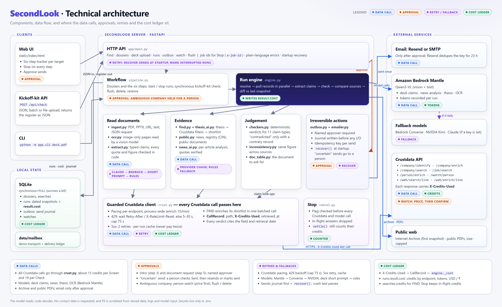
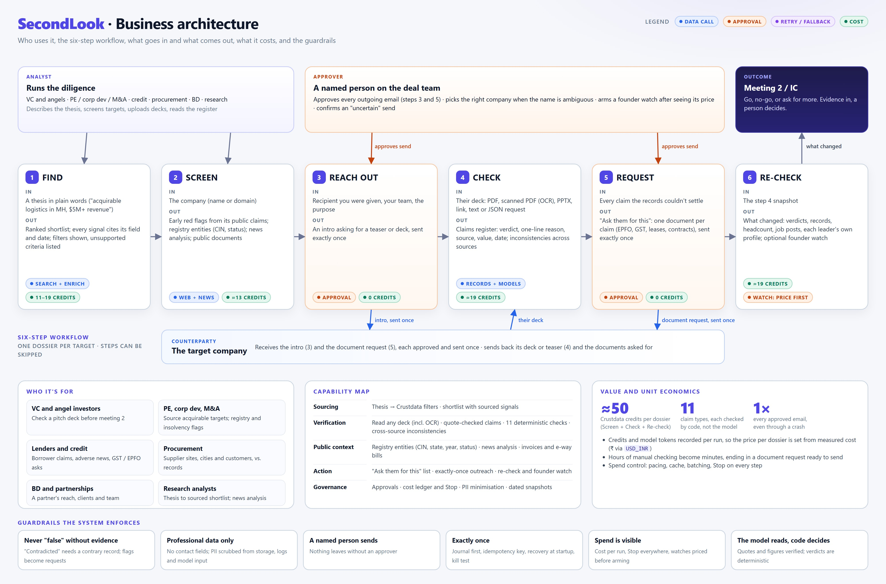
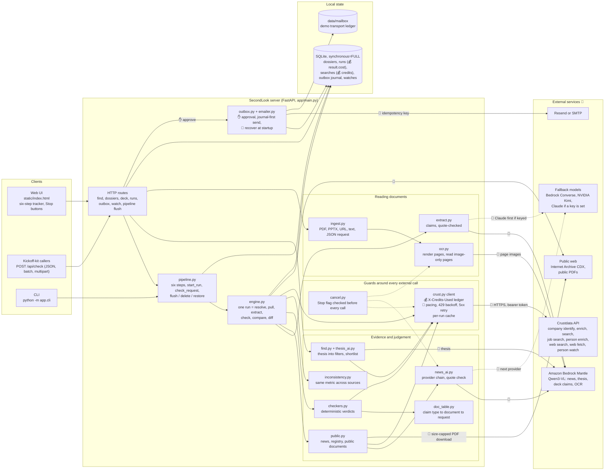
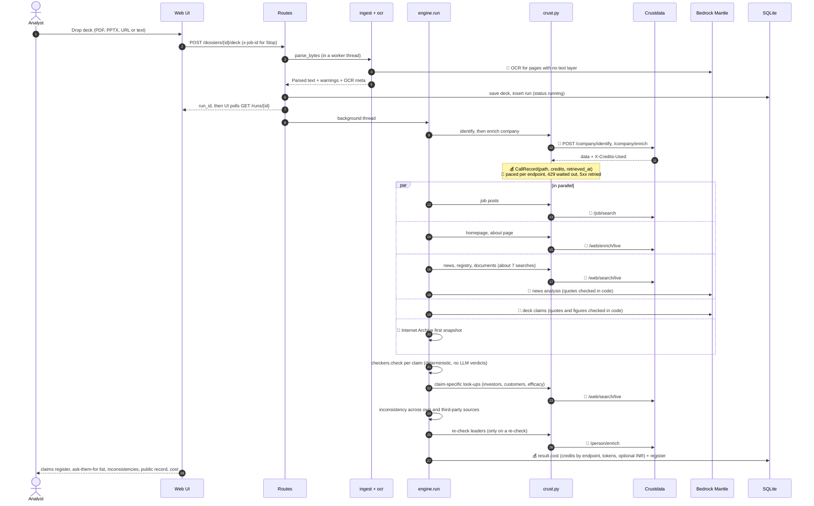
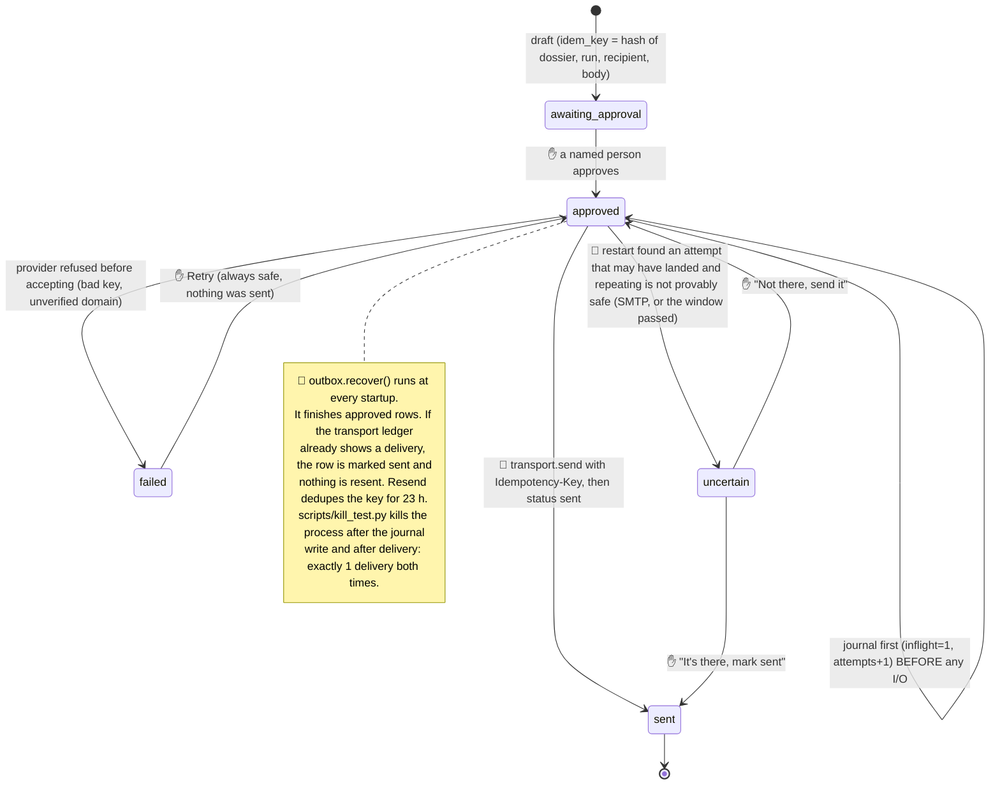
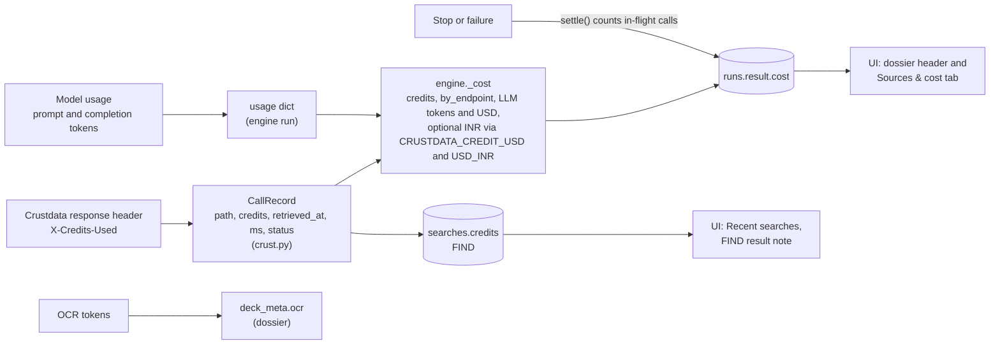
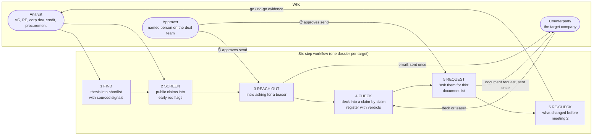
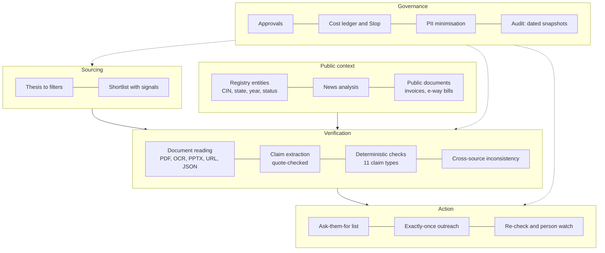

# SecondLook architecture

These two images are drawn from `docs/diagrams/*.html`. Rebuild them with `python scripts/render_diagrams.py`, which uses headless Chrome or Edge at 2x scale. The sections below give the same architecture in detail.

This document has two parts:

1. **Technical architecture.** It shows the components, how data flows through them, and exactly where the **data calls**, **approvals**, **retries** and the **cost ledger** sit.
2. **Business architecture.** It shows who uses SecondLook, the six-step workflow, what goes in and what comes out, what it costs, and the guardrails.

The diagrams are Mermaid and render on GitHub.

Each diagram marks four kinds of point:

| Marker | Meaning |
|---|---|
| 🔌 | **Data call**: leaves the machine for Crustdata, a model, or a public site |
| ✋ | **Approval**: a named person must act before anything irreversible or recurring happens |
| 🔁 | **Retry or fallback**: what happens when a call fails, is rate-limited or is stopped |
| 💰 | **Cost ledger**: where credits and model tokens are recorded |

---

## Part 1: Technical architecture

### 1.1 Components

**What each layer owns**

| Layer | Files | Responsibility |
|---|---|---|
| Clients | `static/index.html`, `app/cli.py` | The six-step tracker, Stop on every step, and approvals in the page |
| Routes | `app/main.py` | HTTP, job ids for Stop (`x-job-id`), plain-language errors, startup recovery |
| Workflow | `app/pipeline.py` | Dossiers, runs, steps, the synchronous kickoff-kit check, flush and delete |
| Run engine | `app/engine.py` | One dated snapshot: resolve, pull, extract, check, compare, diff |
| Reading | `app/ingest.py`, `app/ocr.py`, `app/extract.py`, `app/htmltext.py` | Any document into text, then text into typed claims |
| Evidence | `app/public.py`, `app/news_ai.py`, `app/find.py`, `app/thesis_ai.py` | Public record, news analysis, thesis into Crustdata filters |
| Judgement | `app/checkers.py`, `app/inconsistency.py`, `app/doc_table.py` | Deterministic verdicts, conflicts between sources, the document to ask for |
| Guards | `app/crust.py`, `app/cancel.py` | Every Crustdata call: pacing, retries, cache, cost ledger, Stop |
| Irreversible actions | `app/outbox.py`, `app/emailer.py` | Approval by a named person, journal-first, exactly-once delivery |
| State | `app/store.py` (SQLite) | Dossiers, runs, searches, outbox journal, watches |

### 1.2 Data flow of one run (Screen, Check or Re-check)

Stop (`app/cancel.py`): the run's flag is checked at every stage and before every Crustdata or model call. A call already in flight is abandoned and its answer thrown away. `Crust.settle()` waits for such calls to come back so their credits still reach the ledger, and the run is saved as `cancelled` with its cost.

### 1.3 Exactly-once send (Reach out, step 3, and Request, step 5)

### 1.4 Where data calls, approvals, retries and the cost ledger sit

**🔌 Data calls**

| Call | Where | When | Typical cost |
|---|---|---|---|
| `/company/search` | `find.search`, via `crust.company_search` | FIND | about 5.5 to 6.5 credits |
| `/company/enrich` (batched for FIND) | `crust.enrich_companies` / `enrich_company` | FIND signals, every run | 2 credits per company |
| `/company/identify` | `engine.resolve` | first run of a dossier | small |
| `/job/search` | `crust.jobs` | FIND signals, every run | about 0 to 0.06 |
| `/web/search/live` | `public.py`, `checkers.py` | news, registry, documents, claim look-ups | 1 per search |
| `/web/enrich/live` | `engine._fetch_site`, `ingest.parse_url`, `public.news` | site pages, deck URL, article text | 1 to 2 |
| `/person/enrich` | `engine._diff` | re-check of leaders | per profile |
| `/watch/person` | `main.watch_preview` / `watch_create` | step 6, opt-in | preview free; 50 credits per change detected |
| Bedrock Mantle (Qwen3-VL) | `news_ai`, `thesis_ai`, `extract`, `ocr` | news, thesis, deck claims, OCR | tokens, recorded |
| Internet Archive CDX | `engine.archive_first` | every run | free |
| Public PDFs | `public._download_pdf_text` | documents (2 per run, 8 MB cap, never executed) | free |
| Resend / SMTP | `outbox` transports | only after approval | provider pricing |

**✋ Approvals (a person decides; the machine never does these alone)**

| Gate | Where | Why |
|---|---|---|
| Send the intro (step 3) and the request list (step 5) | `POST /api/outbox/{key}/approve` (named approver required) | outward-facing and irreversible |
| Resend or mark an "uncertain" send | `/retry` with `confirm_not_sent`, `/mark-sent` | a duplicate email can't be recalled |
| Pick the right company when the name is ambiguous | run status `needs_person`, `POST /runs/{id}/resolve` | wrong company means wrong evidence |
| Arm a person watch | preview shows the per-change price, then an explicit confirm | recurring spend |
| "Needs confirmation" flags (CIRP, adverse news) | become document requests, never verdicts | a search snippet is not a registry extract |
| Flush the pipeline or delete a target | confirm screen, with undo or restore | bulk change |

**🔁 Retries and fallbacks**

| Failure | Handling | Where |
|---|---|---|
| Crustdata 429 (rate limit) | waits `Retry-After` / `X-RateLimit-Reset`, else 5, 10, 20, 30 s; all callers of that endpoint back off together; gives up after `CRUSTDATA_MAX_WAIT` (75 s) with a plain sentence | `crust._send`, `_retry_after`, `_blocked` |
| Bursting past the limit | process-wide sliding window per endpoint (`/company/enrich` 15/min by default) | `crust._reserve`, `LIMITS` |
| Crustdata 5xx | 2 retries (1.5 s, 3 s) | `crust._send` |
| Same question twice in one run | per-run cache, so it is never paid for twice | `Crust._cache` |
| `/job/search` sort not allowed | retried unsorted | `crust.jobs` |
| Bad or unknown domain | identify by name, narrowed by city; else held for a person | `engine.resolve` |
| News, thesis or deck model fails | provider chain Mantle, then Bedrock Converse (`global.` profile retry), then NVIDIA | `news_ai.call` |
| Deck model returns nothing | short prompt; then the rule extractor fills missing claim types | `extract._extract_bedrock`, `extract.extract` |
| Thesis model fails | rule-based thesis reader | `thesis_ai.interpret` |
| One OCR page fails | reported; other pages kept | `ocr.ocr_pages` |
| Process killed mid-send | `outbox.recover()` at startup, keyed by `idem_key` | `outbox.recover` |
| Server restarted mid-run | run marked "interrupted", with Try again in the UI | `main._startup` |
| A person presses Stop | no new calls; in-flight answers dropped, their credits still counted | `cancel.py`, `Crust.settle` |

**💰 Cost ledger**

Measured on live runs: FIND about 11 to 19 credits (one search plus one batched enrich), Screen about 13 credits, Check about 19 credits. Model time: news analysis about 11 s, thesis about 5 s, deck claims 10 to 25 s, OCR about 6 s a page.

### 1.5 Trust boundaries and data handling

- **Secrets** live only in `.env` (git-ignored): the Crustdata token, the Bedrock key and mail credentials. They are never written to the database or logs.
- **PII**: no contact fields are requested from Crustdata. Emails and phone numbers are scrubbed from stored public data, removed from deck text before it reaches a model, and masked in logs (`RedactPII`).
- **Model output is never a verdict.** Models only extract or summarise. Every quote is checked against the source text in code, and figures must appear in their quote. Verdicts come from `checkers.py`, and "contradicted" requires a contrary record in hand.
- **Untrusted input**: decks and public PDFs are parsed, never executed. Downloads are size-capped. Google redirect links (bot checks) are never fetched.

---

## Part 2: Business architecture

### 2.1 Actors and the value chain

Steps can be skipped. A deck that arrives unasked goes straight to step 4.

### 2.2 What goes in and what comes out at each step

| Step | Input | Output | Data used | Typical cost |
|---|---|---|---|---|
| 1 Find | a thesis in plain words | ranked shortlist; each signal cites its field and date; filters shown, unsupported criteria listed | company search and batched enrich, job search; thesis model | 11 to 19 credits |
| 2 Screen | the company (name or domain) | early red flags, registry entities, news analysis, public documents, needs-confirmation flags | enrich, job search, web search and fetch, archive; news model | about 13 credits |
| 3 Reach out | recipient, your team, purpose | intro email, ✋ approved and sent exactly once | none (local) | 0 credits |
| 4 Check | deck (PDF, scanned PDF, PPTX, URL, text, JSON request) | claims register: verdict, reason, source field or URL, value, date; inconsistencies | as step 2, plus claim look-ups; deck model and OCR | about 19 credits |
| 5 Request | the register | one document per unsettled claim (EPFO, GST, leases, contracts…), ✋ sent once | none (local) | 0 credits |
| 6 Re-check | the earlier snapshot | what changed: verdicts, records, headcount, job count, leaders; optional person watch | as step 4, plus person enrich; watch is opt-in | about 19 credits, plus 50 per watch change |

### 2.3 Capability map

### 2.4 Value and unit economics

- **Unit of work**: one dossier, meaning one target taken through Screen, Check and Re-check. That's about 50 Crustdata credits plus model tokens, all recorded per run, so the per-dossier price can be set from measured cost (`CRUSTDATA_CREDIT_USD` and `USD_INR` give a rupee figure).
- **Time saved**: claim-by-claim checking, registry look-up and news reading that would otherwise be done by hand, plus a ready-to-send document request.
- **Risk reduced**: every verdict is sourced and dated, and contradictions require contrary evidence. Outreach is approved and never duplicated. Recurring spend (watches) needs explicit consent.
- **Cost control**: per-endpoint pacing, a per-run cache, batching, Stop on every step, and visible credits before and after each step.

### 2.5 Guardrails (business rules the system enforces)

| Rule | Enforced by |
|---|---|
| Never call a claim false without contrary evidence | `checkers.py` (contradicted only with a record), flags become requests |
| Founders' professional data only, no contact data | Crustdata field whitelist, `scrub()`, `RedactPII` |
| Nothing leaves the building without a named person | `outbox.approve_and_send` requires an approver |
| Exactly once, even through crashes | journal-first, idempotency key, `recover()`, kill test |
| Spend is visible and stoppable | cost ledger per run, Stop, preview-then-confirm for watches |
| The model reads; code decides | quote and figure checks, deterministic checkers |
