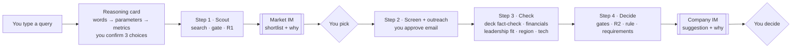

# Walkthroughs — three requests from input to final output

**Part A** (§1–§7): "acquirable logistic companies in maharashtra" → Market IM → Company IM · **Part B** (§8): *"Find ten Indian B2B software companies founded since 2023 whose team grew by half in the last six months, and tell me who founded each and what they did before."* → Research Memo · **Part C** (§9): *"Which Indian fintech companies are hiring the most engineers this quarter, and what does their hiring say about what each will launch next?"* → Research Memo with labelled inferences.

> Each request is followed from what you type to the memo you decide on. Company names, people and figures are **samples for illustration**, not real companies. Market-size figures appear as `[cited range]`; at run time they are filled only from quote-locked, reliable sources. Every score below is reproduced by `tools/rubric_check.py`.
> Standards: [`STANDARDS.md`](./STANDARDS.md) (sources §3, verdict classes §2, metrics §4, query reasoning §5, rubrics §6, memo §7). Design: [`ARCHITECTURE.md`](./ARCHITECTURE.md).



---

## 1. Input: what you type, and how Data Designer reasons about it

**You type:** `acquirable logistic companies in maharashtra`

### 1.1 Reasoning card (shown before anything runs)

Each word is reasoned into the parameters it implies (STANDARDS §5). Nothing outside the term library is applied without your confirmation.

| Word | What it means here (intent) | Parameters → metrics · threshold | Role | Measured at |
|---|---|---|---|---|
| **acquirable** | *Can it be bought?* | private or LLP (AQ-01) · not acquired or a subsidiary (AQ-02) · active, not insolvent (AQ-03) | hard | Step 1 |
| | | revenue ₹25–400 cr, within buyer capacity (AQ-04) · founder-led (AQ-05) · no institutional round in 24 months (AQ-06) | soft | Step 1 → 3 |
| | *Is it worth buying?* | **strong financial ratios**: health grade ≥ B; solvency ≥ 3 (D/E ≤ 0.6, ICR ≥ 4, DSCR ≥ 1.5); cash quality ≥ 2 (CFO/EBITDA ≥ 60%); no earnings-quality flag | min-band | Step 3 (financials are not public) |
| | | **sound tech claims**: tech soundness TC-C ≥ 2 | min-band | Step 1 (public) → 3 |
| | | **capable team**: leadership fit ≥ FIT WITH GAPS | min-band | Step 1 (partly) → 3 |
| | | **clean governance**: ≤ 1 governance flag · no confirmed sanctions or material litigation | min-band + gate | Step 3 |
| **logistic** | sector | 3PL, warehousing, freight forwarding, road transport, cold chain, last-mile, courier · NIC 49/52/53 | search filter + hard | Step 1 |
| **in maharashtra** | geography | operates in Maharashtra (FP-01; GST state code 27) · regional fit RG-C (target-region share + fit with the client's network) | hard + scored | Step 1 → 3 |

### 1.2 Draft mandate (generated from the card)

```yaml
mandate_id: M-2026-11-22-014        # version 1 · rubric R1-2026.11.22-2 · terms.yaml v3
purpose: acquisition_target         # from "acquirable"
profile: target
constraints:
  industry: {in: [3PL, warehousing, freight_forwarding, road_transport, cold_chain, last_mile, courier], hard: true}  # from "logistic"
  location: {state: Maharashtra, gst_state_code: "27", basis: operates, hard: true}                                # CONFIRM basis
  AQ-01..03: {hard: true}                                                                                          # from "acquirable"
  AQ-04_revenue_inr_cr: {between: [25, 400], weight: 3}                                                            # ASSUMED from client size — CONFIRM
  AQ-05_founder_led: {weight: 2}
  AQ-06_no_institutional_round_24m: {weight: 1}
  headcount: {between: [50, 2000], weight: 1}                                                                      # default
requirements:                       # min-band requirements from "acquirable" (worth buying)
  C2_health_grade: ">= B"
  solvency_pillar: ">= 3"
  cash_quality_pillar: ">= 2"
  earnings_quality_flag: none
  C11_tech_soundness: ">= 2"
  C9_leadership_fit: ">= 2.5"       # FIT WITH GAPS
  C5_governance: ">= 3"
exclusions: [client_competitors, existing_vendors]
include_listed: false               # CONFIRM
media_list: media.yaml v2           # reliable outlets, owned by compliance
limits: {max_credits: 450, deadline_min: 20}
```

**Three confirmation questions:**

| Question | Options | Default |
|---|---|---|
| What does "in Maharashtra" mean? | **Operates there** · majority of operations there (≥ 40%) · headquartered there | Operates there |
| Size for "acquirable"? | ₹25–400 cr revenue (from client profile) · custom | ₹25–400 cr |
| Include listed companies? | No · Yes | No |

You press **Run**.

---

## 2. Step 1 — Scout

### 2.1 Searches compiled from the mandate

| Stream | Call | Catches | Results (sample) | Credits |
|---|---|---|---|---|
| A · HQ in state | `company/search`: industry set · `locations.state` = Maharashtra · headcount 50–2000 | Maharashtra-headquartered firms | 300 companies | 69 |
| G · People in state | `person/search`: `geo_distance` 60 km around Mumbai, Pune, Nagpur, Nashik, Chhatrapati Sambhajinagar · employer industry ∈ set → group by employer (≥ 10 people) | Firms headquartered elsewhere that operate in Maharashtra | 2,000 people → 140 employers | 60 |
| C · Jobs in state | `job/search`: logistics roles in those cities, 90 days → group by company | Firms expanding in Maharashtra | 900 openings → 110 companies | 27 |
| B · Reliable news | `web/search/live` (news) restricted to the `media.yaml` allow-list; press releases and brand content detected and set aside as self-published | Deals, facility openings, funding | 8 queries → 15 companies | 8 |
| F · Client lists | kickoff kit | Exclusions | — | 0 |

Merge and dedup → 380 companies → pre-scored → **top 100 enriched** (200 credits) → GSTIN found on the websites of the top 30 (30 credits). **Total ≈ 394 of 450 credits.**

### 2.2 Constraint gate

| Result | Count | Reasons |
|---|---|---|
| Fail | 38 | listed 4 · acquired or subsidiary 7 · not logistics-core 15 · struck off / inactive 3 · no Maharashtra presence 9 |
| Likely fail (estimate only) | 10 | revenue band above ₹400 cr → "Excluded on estimates" (restorable) |
| Pass or unknown | 52 | scored on R1 |

### 2.3 HQ in Delhi, operating in Mumbai, most of the fleet in Mumbai — does it show up?

**Yes.** Company C (sample) is that case:

| Evidence | Value | Tier | Result |
|---|---|---|---|
| Registered office (MCA) | New Delhi | T1 | HQ state = Delhi |
| Stream A (HQ filter) | not found | — | an HQ-only search would **miss** it |
| Stream G (people) | 226 of 365 India-located profiles within 60 km of Mumbai | T2 | found |
| Stream C (jobs) | 32 of 44 openings in Mumbai/Bhiwandi | T2 | found |
| Reliable news | tier-A business daily, own reporting: "opens Bhiwandi hub" | T1-M | supports Maharashtra presence |
| GSTIN on its invoice page | starts `27…` → PAN → GST search by PAN: active in 27 Maharashtra, 07 Delhi, 24 Gujarat, 29 Karnataka; 1 cancelled | T1 | **FP-01 = Yes** |
| **Regions of operation (RG-01)** | West: Maharashtra, Gujarat · North: Delhi · South: Karnataka | T1 | 4 states, 3 zones |
| Target-region share (RG-02) | mean(62% staff, 72.7% openings, 50% sites) = **61.6%** | derived | 4 points |
| Network fit (RG-03) | client (sample) is present in Delhi, Gujarat and Karnataka, weak in Maharashtra → 1 of 4 states adds coverage = 25% | derived | 2 points |
| **Regional fit (RG-C)** | mean(4, 2) | | **3 points** |
| "Most of our fleet operates from Mumbai" | website only | T4 | 🟡 UNVERIFIED (U2) now; checked at Step 3 |

Under "headquartered there", Company C fails with the reason "registered office Delhi (MCA)", and switching the basis brings it back.

### 2.4 R1 scorecard for Company C

| Criterion | Value | Pts floor / ceil | Wt | Floor | Ceiling |
|---|---|---|---|---|---|
| S1 Constraint fit | soft weight met 6 of 7 (AQ-06 unknown) = 85.7%; ceiling 100% | 3 / 4 | 15 | 11.25 | 15.00 |
| S2 Growth | headcount YoY 24% | 3 / 3 | 15 | 11.25 | 11.25 |
| S3 Scale fit | ₹150–220 cr (estimate), middle of the band | 4 / 4 | 10 | 10.00 | 10.00 |
| S4 Leadership fit (public) | role coverage 80% (no tech head) → 3 · median domain experience 13.5 y → 3 · churn 12% → 3 | 3 / 3 | 15 | 11.25 | 11.25 |
| S5 Org mix | ops + sales 71%, inside 60–85% | 4 / 4 | 5 | 5.00 | 5.00 |
| S6 Market | segment growth 11% (cited) → 1 · +15 pp vs competitors → 2 | 3 / 3 | 10 | 7.50 | 7.50 |
| S7 PMF | hiring ↑ ✓ · traffic ↑ ✓ · rating 3.6 ✗ · 1 verified customer ✗ | 2 / 2 | 10 | 5.00 | 5.00 |
| S8 **Regional fit** | RG-C (above) | 3 / 3 | 10 | 7.50 | 7.50 |
| S9 Quality signals | financials not public (0 / 4) · public tech claims 75% verified → 3 | 1.5 / 3.5 | 10 | 3.75 | 8.75 |
| **Total** | coverage 92.9% · no risk flags | | 100 | **72.50** | **81.25** |

Requirements from "acquirable": tech soundness ≥ 2 **met** (3) · leadership ≥ 2.5 **met** (3) · financial ratios and governance **open** (to confirm at CHECK) · none unmet. Label: floor ≥ 60, no flags → **RECOMMEND**.

### 2.5 Step 1 output: the Market IM (excerpt)

> **MARKET IM · M-2026-11-22-014 · Acquirable logistics companies operating in Maharashtra** · R1-2026.11.22-2 · DRAFT — awaiting your selection
>
> **Suggestion:** screen the **8 RECOMMEND** companies, starting with C, A and B (R1 floors 66–73, no risk flags). Each has an active Maharashtra GST registration, revenue inside ₹25–400 cr (estimate), growth above its competitor set, and no unmet requirement. Financial-ratio and governance requirements are open for all of them and will be tested at CHECK.
>
> **How the query was read:** see the reasoning card (§1.1).
> **Market view:** Maharashtra logistics and warehousing `[cited range: publisher, date]` (third-party estimate); segment growth `[cited CAGR]`.
> **Funnel:** 380 found → 100 enriched → 38 failed the gate · 10 excluded on estimates · 52 scored → 8 RECOMMEND · 19 CONSIDER · 25 NOT RECOMMENDED · 394 credits.
>
> | # | Company (sample) | HQ | Regions of operation | MH share | Revenue (est.) | R1 floor–ceiling | Requirements | Label |
> |---|---|---|---|---|---|---|---|---|
> | 1 | Company C | Delhi | West, North, South (4 states) | 62% | ₹150–220 cr | 72.50–81.25 | 2 met · 2 open | RECOMMEND |
> | 2 | Company A | Pune | West (1 state) | 100% | ₹60–90 cr | 70.00–80.00 | 2 met · 2 open | RECOMMEND |
> | 3 | Company B | Mumbai | West, South (3) | 85% | ₹200–310 cr | 66.25–80.00 | 1 met · 3 open | RECOMMEND |
> | 4 | Company F | Nagpur | West, Central (2) | 92% | ₹30–45 cr | 63.75–75.00 | 2 met · 2 open | RECOMMEND |
> | 5 | Company H | Bengaluru | South, West (5) | 41% | ₹90–140 cr | 62.50–71.25 | 2 met · 2 open | RECOMMEND |
> | … | 3 more RECOMMEND (floors 60.00–62.50) · 19 CONSIDER · 25 NOT RECOMMENDED | | | | | | | |
>
> **Excluded on estimates:** Company G (sample): revenue band ₹520–700 cr is above ₹400 cr (Crustdata estimate, record date …).

You pick **Company C** → **Finalise**.

---

## 3. Step 2 — Screen and reach out

Light people check: no sanctions, PEP or debarment matches for 4 directors; no **confirmed** adverse media (one unconfirmed blog mention is shown, not scored). The teaser request is drafted from ledger facts only (Mumbai and Bhiwandi operations: GST + tier-A report). You **approve** → it is sent once to the test inbox → the run waits in `AWAITING_PACK` → their reply with a **14-slide deck** and FY24–FY26 audited statements starts Step 3.

---

## 4. Step 3 — Check

37 checkable statements are extracted from the deck: 23 business claims (14 critical), 9 leadership-bio claims and 5 technology claims.

### 4.1 Deck fact-check (slide map, excerpt)

| Slide | Claim (sample) | Crit. | Class | Code | Evidence (tier · record date) |
|---|---|---|---|---|---|
| 2 | "Incorporated in 2011" | ✓ | ✅ VERIFIED | V1 | MCA master data (T1) |
| 3 | "GST-registered in 6 states" | — | ❌ FALSE | F1 | GST search by PAN: 4 active, 1 cancelled (T1) |
| 4 | "FY26 revenue ₹186 cr" | ✓ | ✅ VERIFIED | V2 | FY26 AOC-4 filed Oct 2026 (T1) |
| 4 | "640 employees" | ✓ | ✅ VERIFIED | V4 | EPFO establishment search: 655 members (T1) |
| 5 | "48 trucks" | ✓ | ✅ VERIFIED | V1 | 48 RC copies; 20 sampled match VAHAN (T1) |
| 5 | "Most of our fleet operates from Mumbai" | ✓ | 🟢 PARTIALLY | P3 | 33 of 48 RCs Maharashtra-registered (T1); operating base rests on their e-way-bill summary, 71% Maharashtra origin (T3) |
| 6 | "4.2 lakh sq ft across 6 sites" | ✓ | 🟢 PARTIALLY | P3 | 5 of 6 lease deeds + GST places = 3.6 lakh sq ft (T3/T1) |
| 7 | "5-year contract with a national FMCG company (2026)" | ✓ | ✅ VERIFIED | V5 | tier-A business daily, own reporting (T1-M) |
| 7 | "Serves 3 of India's top-10 e-commerce firms" | ✓ | 🟡 UNVERIFIED | U2 | deck only · missing: customer references |
| 7 | "Top customer contract renewed to 2029" | ✓ | ⚪ NOT VERIFIABLE | N1 | missing: contract extract |
| 9 | "Best 3PL 2025" award | — | 🟡 UNVERIFIED | U2 | found only on a "brand connect" page (media tier D = self-published); not on the issuer's winners page (absence ≠ false) |
| 10 | "ISO 9001:2015 certified" | — | ⏳ OUTDATED | O2 | certificate copy expired Jan 2025 |
| 14 | "₹500 cr revenue by FY29" | — | ⚫ NOT CHECKED | X1 | projection |

**Business claims:** ✅ 15 · 🟢 2 · 🟡 2 · ⏳ 1 · ⚪ 1 · ❌ 1 · ⚫ 1 (critical: 10 ✅ · 2 🟢 · 1 🟡 · 1 ⚪).

### 4.2 Leadership fit (slide 12, "Our team")

| Leader (sample) | Bio claims → class | Domain yrs | Senior role at an org ≥ this size? | Track record |
|---|---|---|---|---|
| CEO, founder | director since 2011 ✅ V1 (MCA) · ex-VP ops, national 3PL 🟢 P5 · "20+ years in logistics" 🟢 P5 | 22 | yes (4,000-staff 3PL) | clean |
| CFO | KMP since 2021 ✅ V1 (MCA) · "12 years in finance" 🟢 P5 · "led a ₹200 cr debt raise" 🟡 U2 | 6 (in logistics) | no | clean |
| COO | "ran a 2 million sq ft network at prior employer" ✅ V5 (tier-A report) | 13 | yes | clean |
| Head of Sales | director since 2022 ✅ V1 · ex-regional head, e-commerce logistics 🟢 P5 | 14 | yes | clean |

| Metric | Value | Pts |
|---|---|---|
| LF-01 Role coverage | 4 of 5 required (no tech head, although the deck claims a "tech-led visibility platform") = 80% | 3 |
| LF-02 Domain experience | median 13.5 years | 3 |
| LF-03 Scale experience | 3 of 4 = 75% | 4 |
| LF-04 Track record | 100% clean | 4 |
| LF-05 Bio integrity | (4 ✅ + 4 × 0.75 + 0.5) ÷ 9 = 83.3% | 3 |
| LF-06 Stability | CXO churn 12% | 3 |
| LF-07 Strategy–capability | pillars: Maharashtra densification (COO ✓) · e-commerce growth (Sales ✓) · tech-led platform (✗) · cold-chain entry (COO, 3 y ✓) = 75% | 3 |
| **LF-C** | mean 3.29 → rounded down **3.0** | **FIT WITH GAPS** — gap: no technology leader for the "tech-led" pillar |

### 4.3 Technology claims (slide 8)

| Claim | Class | Evidence |
|---|---|---|
| In-house WMS | 🟢 P | job posts for WMS developers (T2) |
| Real-time tracking app | ✅ V | app-store listing (independent platform) |
| API integrations with 3 e-commerce marketplaces | 🟡 U2 | deck only |
| IoT temperature sensors across cold chain | ⚪ N1 | missing: device inventory or vendor invoice |
| AI route optimisation | 🟡 U2 | deck only |

TC-01 = 55% (ceiling 75%) → 1 (ceiling 3). TC-02 engineering share 3% (tech-led claimed) → 1. **TC-C = 1.0 (ceiling 2.0).**

### 4.4 Financial analysis (FY26)

| Pillar | Metrics (value → points) | Pillar |
|---|---|---|
| Growth | revenue CAGR 21% → 3 | 3 |
| Profitability | EBITDA 9.4% → 2 · PAT 3.1% → 2 · ROCE 16% → 3 · ROE 14% → 3 | 2.5 |
| Liquidity | current 1.42 → 2 · quick 1.05 → 3 | 2.5 |
| Solvency | D/E 0.55 → 3 · net debt/EBITDA 1.0 → 4 · ICR 4.8 → 3 · DSCR 1.6 → 3 | 3 |
| Working capital | DSO 78 d → 2 · CCC 52 d → 2 | 2 |
| Cash quality | CFO/EBITDA 78% → 3 · FCF margin 1.8% → 2 | 2.5 |
| Earnings quality | Z″ 3.1 → 4 · M −2.41 → 4 · F-score 6 → 3 | 4 |
| **Health grade** | mean 2.79 | **B** |

---

## 5. Step 4 — Decide (R2, target profile)

**Gates:** G1 0.98 ✓ · G2 active ✓ · G3 no hits ✓ · G4 no critical FALSE ✓ · G5 in mandate ✓ · G6 statements consistent ✓ · G7 coverage 97.0% ✓ · G8 no false leadership credential ✓

| Criterion | Value | Pts floor / ceil | Wt | Floor | Ceiling |
|---|---|---|---|---|---|
| C1 Claim integrity (deck) | (10 + 1.5 + 0.5) ÷ 14 = 85.7% → 3, −1 for the non-critical FALSE; ceiling 92.9% → 4 − 1 | 2 / 3 | 20 | 10.00 | 15.00 |
| C2 Financial health | grade B | 3 / 3 | 20 | 15.00 | 15.00 |
| C3 Growth | revenue CAGR 21% | 3 / 3 | 10 | 7.50 | 7.50 |
| C4 Market position | segment 11% → 1 · +12 pp vs competitors → 2 | 3 / 3 | 10 | 7.50 | 7.50 |
| C5 Governance | 1 flag: FY24 filing late | 3 / 3 | 5 | 3.75 | 3.75 |
| C6 Reputation & legal | none confirmed | 4 / 4 | 5 | 5.00 | 5.00 |
| C7 Mandate fit, verified | 85%; ceiling 100% | 3 / 4 | 5 | 3.75 | 5.00 |
| C9 **Leadership fit** | FIT WITH GAPS | 3 / 3 | 15 | 11.25 | 11.25 |
| C10 **Regional fit** | MH share 63.4% (fleet included) → 4 · network fit 25% → 2 | 3 / 3 | 5 | 3.75 | 3.75 |
| C11 **Tech soundness** | TC-C | 1 / 2 | 5 | 1.25 | 2.50 |
| **Total** | | | 100 | **68.75** | **76.25** |

**Rule 4:** floor 68.75 is ≥ 50 and < 75 → **PURSUE WITH CONDITIONS**.

**"Acquirable" requirements:**

| Requirement | Status |
|---|---|
| Health grade ≥ B | met (B) |
| Solvency ≥ 3 | met (3) |
| Cash quality ≥ 2 | met (2.5) |
| No earnings-quality flag | met |
| Leadership ≥ FIT WITH GAPS | met (3) |
| Governance ≤ 1 flag | met |
| Tech soundness ≥ 2 | **open** (floor 1, ceiling 2) → condition |

None is unmet, so no cap applies.

---

## 6. Final output: the Company IM (excerpt)

> **COMPANY IM · IM-2026-11-29-003 · Company C (sample) · CIN U……DL2011PTC…… · target · R2-2026.11.22-2 (sha 41d7…) · DRAFT — awaiting decision**
>
> ### 1 · Suggestion: **PURSUE WITH CONDITIONS**
> **Score 68.75–76.25 · coverage 97.0% · rule 4 · requirements: 6 met, 1 open, 0 unmet**
> **Leadership: FIT WITH GAPS (3/4)**: experienced, stable and clean team; no technology leader for the deck's "tech-led" pillar.
> **Region:** operates in 4 states across West, North and South; Maharashtra share 63% (GST, staff, openings, sites, fleet); adds 1 state where the client is weak.
>
> **Why pursue**
> 1. **It is outgrowing its market.** Revenue +21% a year FY23–FY26 (MCA filings) vs competitor median 9% and segment growth 11% (`[publisher, date]`, estimate) → C3 3/4, C4 3/4.
> 2. **Its ratios are strong where a buyer needs them.** D/E 0.55, net debt/EBITDA 1.0, interest cover 4.8, DSCR 1.6 (solvency 3/4); Z″ 3.1 safe, M-score −2.41 clean → health grade B, meeting the "acquirable" financial requirements.
> 3. **It fits the Maharashtra mandate with a proven team.** 63% Maharashtra footprint (GST 27, VAHAN-sampled fleet, tier-A report of the Bhiwandi hub). The CEO, COO and Head of Sales have run larger operations, and none of the leadership has a link to a failed company.
>
> **What holds it back**
> 1. **The deck overstates facts.** "GST-registered in 6 states" is ❌ FALSE (4 active, 1 cancelled); the "Best 3PL 2025" award appears only in paid brand content → C1 2/4.
> 2. **The tech story is thin.** Only 55% of tech claims are verified; engineering is 3% of staff; there is no tech head → C11 1/4, and the "sound tech" requirement is open.
> 3. **Margins are thin and collections slow.** EBITDA 9.4%, DSO 78 days, FCF margin 1.8% (each 2/4).
>
> **Conditions** (by points each adds)
> 1. Contract extract for the top-customer renewal → +5.00
> 2. Evidence for the API integrations and IoT sensors (integration listings, device invoices) → +1.25, and closes the tech requirement
> 3. Written reconciliation of GST registrations → credibility; needed before any term sheet
> 4. Plan or candidate for a technology head → leadership gap
> 5. Receivables ageing > 90 days → working-capital risk
>
> **Would be PURSUE if:** conditions 1 + 2 are met → floor **75.00** (rule 3), with every requirement met.
>
> *Suggestion only. Decision by: Head of Corporate Development.* [Accept] [Override + reason]
>
> **2** Scorecard (§5) · **3** Company snapshot + regions map · **4** Market & competition · **5** Financial analysis (§4.4) · **6** Deck fact-check (§4.1) · **7** Leadership fit (§4.2) · **8** Technology (§4.3) · **9** Risks & mitigants · **10** Next steps · **11** Sources, each with tier and media tier · cost of this job

---

## 7. How the answer is reached, in one line per step

| Question | Rule that answers it |
|---|---|
| What did the query mean? | Term library → intent → parameters → metric IDs → thresholds → role (STANDARDS §5) |
| Which sources count? | Tiers T1 › T1-M (reliable media, own reporting) › T2 › T3 › T4; press releases and brand content are self-published (§3) |
| Is the company in scope? | Constraint gate (hard constraints, location basis) |
| Should we look at it? | R1 → RECOMMEND / CONSIDER / NOT RECOMMENDED, capped by unmet requirements |
| Is each deck claim true? | First-match procedure → 7 classes with reason codes (§2) |
| Is the leadership fit? | LF-01…07 → FIT / FIT WITH GAPS / WEAK FIT / NOT FIT, with the gap named (§4.7) |
| Where does it operate? | RG-01 regions · RG-02 target share · RG-03 network fit → regional fit (§4.3) |
| What do we suggest? | Gates → R2 floor–ceiling → fixed rule → requirement cap (§6.5) |
| What would change it? | Smallest set of asks that crosses the next threshold, preferring the set that also closes requirements |
| Who decides? | You: accept or override with a reason; both are journaled into the IM |
| Is a list answer complete and honest? | R3: criteria compliance 100%, honest coverage 100%, never padded, premises checked → COMPLETE / PARTIAL / CANNOT ANSWER (STANDARDS §6.8) |
| How strong is an interpretation? | Inference Strength: n postings, share, corroboration → STRONG / MODERATE / WEAK, always labelled "not a verified fact" (STANDARDS §2.4) |

---

## 8. Part B — FIND_LIST: "Find ten Indian B2B software companies founded since 2023 whose team grew by half in the last six months, and tell me who founded each and what they did before."

### 8.1 Reasoning card

| Phrase | Parameter | Measured by | Role | Origin |
|---|---|---|---|---|
| ten | up to 10 rows, ranked by 6-month growth | — | output | from query |
| Indian | HQ country India | `locations.country in ["IND"]` | filter + hard | from query |
| B2B software | software industry + sells to businesses | industry `Software Development` (autocomplete-validated) + B2B classifier on the company's own description, quote-locked | filter + hard | from query |
| founded since 2023 | founding year ≥ 2023 | `basic_info.year_founded => 2023` (T2); CIN year / earliest Wayback capture cross-check | filter + hard | from query |
| team grew by half in the last six months | 6-month headcount growth ≥ 50% | `headcount.growth_percent.6m => 50` (profile-based, T2) | filter + hard | from query |
| (guard) | at least 10 staff today, so 2 → 3 is not "half" | `headcount.total => 10` | hard | **proposed — confirm** |
| who founded each | founders | `company/enrich` `people.founders` (T2) + MCA directors where a CIN is found (T1) | attribute | from query |
| what they did before | 1–2 most recent roles before founding | `person/enrich` `experience.employment_details.past[]` → 🟢 P5 unless T1/T1-M | attribute | from query |

Window: "last six months" = 24 May – 22 Nov 2026 (as of 22 Nov 2026 IST); Crustdata's 6-month growth field, with its record date shown.

### 8.2 Calls and funnel (sample)

| Step | Call | Result | Credits |
|---|---|---|---|
| 1 | `company/search/autocomplete` industry "software" | `Software Development` confirmed | — |
| 2 | `company/search` with the 5 filters (plan §5.3A), `limit 200` | 143 companies | ≈ 47 |
| 3 | client-side sort by `growth_percent.6m`; guard removes 31 with < 10 staff | 112 | 0 |
| 4 | `company/enrich` top 25 (`basic_info, headcount, people, taxonomy, locations`) | descriptions, founders | 50 |
| 5 | B2B classifier (Claude `classify` role, quoted description) | 19 B2B · 4 B2C · 2 ambiguous | LLM tokens |
| 6 | founded-year cross-check (CIN where found, Wayback first capture) | 1 conflict → excluded | ≈ 0 |
| 7 | `person/enrich` founders of the first 10 qualifying | 21 founders | 21 |
| | **Total** | **10 rows** | **≈ 118** |

### 8.3 Output — Research Memo (excerpt)

> **RESEARCH MEMO · RM-2026-11-22-031** · as of 22 Nov 2026 IST · R3 · status **COMPLETE** · confidence **MEDIUM** (most facts come from Crustdata profiles, T2)
>
> **Answer:** 10 Indian B2B software companies founded in 2023 or later more than doubled or grew ≥ 50% in staff over the last six months. Company K (+128%), Company L (+96%) and Company M (+81%) lead. Founders mostly come from product and engineering roles at Indian SaaS and fintech firms (per their public profiles).
>
> | # | Company (sample) | HQ | Founded | Staff 6 mo ago → now | Growth | B2B evidence | Founders → what they did before |
> |---|---|---|---|---|---|---|---|
> | 1 | Company K | Bengaluru | 2023 🟢 P (Crustdata) · ✅ V1 CIN year 2023 | 18 → 41 | +128% 🟢 P1 | "API platform for finance teams" (own description) | F1: Senior PM at a payments company 🟢 P5 · F2: engineering lead at a SaaS firm 🟢 P5 |
> | 2 | Company L | Pune | 2024 🟢 P | 25 → 49 | +96% 🟢 P1 | "compliance automation for manufacturers" | F1: director since 2024 ✅ V1 (MCA); before: plant-ops consultant 🟢 P5 |
> | 3 | Company M | Gurugram | 2023 🟢 P | 32 → 58 | +81% 🟢 P1 | "warehouse software for 3PLs" | F1: ⚪ N1 prior role not found (missing: public profile) |
> | … | 7 more rows | | | | | | |
>
> **Near-misses:** Company X: growth +47% (below 50%). Company Y: consumer app (B2C, quoted). Company Z: profile says 2023, but the domain was first captured in 2019 and the CIN year is 2020 (conflict → excluded). Company W: 3 → 7 staff (+133%), excluded by the 10-staff guard you confirmed.
> **R3:** Q1 100% · Q2a 100% · Q2b 92% (46 of 50 attributes ✅/🟢) · Q3 10/10 · Q4 14% T1 · Q5 n/a · Q6 none.
> **Method:** filters and request JSON (keys redacted); growth = Crustdata headcount from public profiles (lower bound), record dates in the appendix · cost ≈ 118 credits (₹ from the ledger).

---

## 9. Part C — RESEARCH_QA: "Which Indian fintech companies are hiring the most engineers this quarter, and what does their hiring say about what each will launch next?"

### 9.1 Reasoning card

| Phrase | Parameter | Measured by | Role | Origin |
|---|---|---|---|---|
| Indian | HQ country India | `locations.country` / `company.locations.country` = `IND` | filter | from query |
| fintech | technology-first financial-services company | categories from autocomplete (fin, pay, lend, insur, wealth) or industry `Financial Services` + fintech classifier (excludes traditional banks, NBFCs, insurers unless tech-first) | hard | from query + term library |
| hiring the most engineers | rank by **deduped engineering job postings** | `job_details.category = "Engineering"`; dedup (company, title, city, 14 days) | metric | **proxy — postings ≠ hires** (shown) |
| this quarter | 1 Oct 2026 → 22 Nov 2026 (calendar Q4 2026 = Q3 FY2026-27, partly elapsed) | `metadata.date_added => 2026-10-01` | window | resolved by clock |
| what will each launch next | themes in this quarter's engineering postings | `themes.yaml` + clustering with quoted titles → **Inference Strength** | inference | labelled, never a fact |
| (output size) | top 10 | — | output | default — confirm |

### 9.2 Calls and funnel (sample)

| Step | Call | Result | Credits |
|---|---|---|---|
| 1 | autocomplete `taxonomy.categories` ×5 | fintech category values | — |
| 2 | `company/search` India + fintech categories OR Financial Services, `limit 1000`, minimal fields | 1,000 candidate ids | ≈ 30 |
| 3 | `job/search` aggregation: ids + Engineering + date ≥ 1 Oct, group by company id (size 50) | top 50 buckets | ≈ 0 (read `X-Credits-Used`) |
| 4 | cross-check aggregation by `company.basic_info.industries` | consistent top 20 | ≈ 0 |
| 5 | listings for the top 25 (≤ 200 each) → dedup | 1,480 → 1,190 unique postings | ≈ 45 |
| 6 | fintech classifier on the top 25 | 2 incumbents excluded (a bank, an insurer), 1 ambiguous listed | LLM tokens |
| 7 | reliable-media corroboration for the top 10 themes | 4 corroborations found | ≈ 20 |
| | **Total** | **top 10 ranked** | **≈ 95** |

### 9.3 Output — Research Memo (excerpt)

> **RESEARCH MEMO · RM-2026-11-22-032** · as of 22 Nov 2026 IST · window 1 Oct – 22 Nov 2026 · status **COMPLETE** · confidence **MEDIUM** · *Job postings indicate intent to hire, not hires made.*
>
> **Answer:** Company P (41 deduped engineering postings), Company Q (33) and Company R (29) are hiring the most engineers among Indian fintechs this quarter. P's hiring points strongly to credit on UPI. Q and R point, moderately, to card issuing and wealth products.
>
> | # | Company (sample) | Eng postings (deduped) | Raw | Share of all its postings | Top themes |
> |---|---|---|---|---|---|
> | 1 | Company P | 41 | 57 | 62% | credit on UPI · risk ML |
> | 2 | Company Q | 33 | 38 | 55% | card issuing · fraud |
> | 3 | Company R | 29 | 31 | 48% | wealth / brokerage APIs |
> | … | 7 more | | | | |
>
> **What their hiring suggests**
> - **Company P:** Hiring suggests P is building **credit lines on UPI**. INFERENCE (**STRONG**): 11 of 41 engineering postings since 1 Oct (27%), e.g. "Senior Backend Engineer, Credit on UPI". Corroborated by a tier-A business daily reporting P's lending plans (record date …).
> - **Company Q:** Hiring suggests **card issuing / co-branded cards**. INFERENCE (**MODERATE**): 6 of 33 (18%), e.g. "Engineer, Card Issuing Platform"; no independent corroboration.
> - **Company R:** Hiring suggests **wealth/brokerage APIs**. INFERENCE (**MODERATE**): 5 of 29 (17%); no independent corroboration.
>
> **Excluded:** 2 incumbent lenders/insurers (not tech-first by the fintech definition, quoted) · 1 ambiguous (IT-services vendor to banks).
> **R3:** Q1 100% · Q2a 100% · Q2b 100% · Q3 10/10 · Q4 low (postings are T2) · Q5 100% (all inferences labelled) · Q6 none.
> **Method & caveats:** quarter partly elapsed; coverage limited to postings indexed by Crustdata; dedup rule; the request JSON is in the appendix · cost ≈ 95 credits.
