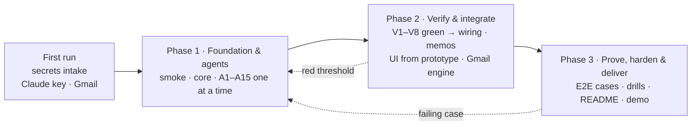

# Data Designer — Workflows: build, run, change, demo, submit

---

## 1. Build workflow (Claude Code loop)

**Per-step loop:**
1. `/phase N` (N = 1, 2, 3) picks the next unticked DoD item.
2. Implement it.
3. `make test` (replay).
4. Run the relevant sub-agent: `backtest-auditor`, `citation-auditor`, `chaos-tester` or `rubric-auditor`.
5. `spec-guardian` + `make secrets-check`.
6. Commit `pN(scope): …`, then push to `hackathon-Rohan`.
7. Tick `PROGRESS.md`.

**Spending credits and tokens:** only `make smoke` (≈ 0 credits, a few hundred Claude tokens, one test email), `make record CASE=…` (budget-capped per case) and `make e2e-live` spend Crustdata credits or Claude tokens. Everything else replays from cassettes and `llm_cache`.

**Branch hygiene:** small commits; never commit `.env`, `data/`, `runs/` or raw reports; rebase on `origin/hackathon-Rohan` before pushing; never force-push.

---

## 2. Runtime workflow (one request)

| # | Step | Who | Output | Journaled? |
|---|---|---|---|---|
| 1 | Query typed or pack uploaded | person | request | — |
| 2 | Reasoning card (A1) | system | parameters, premises, ≤ 3 questions | yes (mandate v1) |
| 3 | Confirm the reading | **person** | mandate vN | yes |
| 4 | Scout / research (A2, A11) | system | candidates, rows | checkpoint |
| 5 | Evidence → quote lock → verdicts (A5–A7) | system | classed facts | checkpoint |
| 6 | Analysis (A8–A10) | system | metrics, leadership, regions | checkpoint |
| 7 | Decision (A12) | system | gates, scores, label, conditions | checkpoint |
| 8 | Memo (A13) | system | Research Memo / Market IM / Company IM | checkpoint |
| 9 | Decide: accept or override + reason | **person** | final decision | yes |
| 10 | Approve each email | **person** | sent exactly once | yes (intent → sent) |
| 11 | Re-check on triggers (A15) | system | diff | checkpoint |

---

## 3. Evidence lifecycle

fetch (gateway) → raw blob (sha256) → passage/field proposed → **quote lock** → evidence row (record date, tier, media tier) → verdict → memo → retention.

- Person evidence: 180 days, or the end of the engagement.
- Public company data: cache TTL per source.
- Purge job keeps hashes only.

---

## 4. Requirement change (organisers change a rule mid-build)

1. Read the change.
2. Identify the config file:
   - output field → `schema.yaml`
   - limits → `limits.yaml`
   - verdict rule → `verdicts.yaml`
   - rubric → `rubric.yaml`
   - query word → `terms.yaml`
   - media → `media.yaml`
   - roles → `roles.yaml`
3. Edit and hot-reload.
4. Add or adjust one golden expectation.
5. `make test e2e`.
6. Commit `change(<id>): …`.

Target: ≤ 5 minutes.

---

## 5. Live-fix playbook (finals: 5 minutes on stage)

| Likely request | Edit | Time |
|---|---|---|
| Add an output field (e.g. "next review date") | `config/schema.yaml` + 1 line in `memo/compose.py` mapping | 2 min |
| Lower the cost limit / deadline | `config/limits.yaml` | 30 s |
| Treat another outlet as reliable / demote one | `config/media.yaml` | 30 s |
| "Acquirable" must also require ROCE ≥ 15% | `config/terms.yaml` → acquirable.requirements += `PR-03 >= 3` | 1 min |
| New required leadership role (e.g. compliance head for NBFC partners) | `config/roles.yaml` | 30 s |
| Change a rubric weight or threshold | `config/rubric.yaml` (version auto-bumps) + golden update | 2 min |
| New verdict tolerance (money ±5%) | `config/verdicts.yaml` | 30 s |
| New email template wording | `config/templates/*.j2` | 1 min |
| Disable a failing source | `config/sources.yaml` `enabled: false` | 30 s |
| Hiring "this quarter" → "last 90 days" | `config/terms.yaml` time-window rule | 1 min |

Always finish with `make test` (replay, < 30 s) and show it green.

---

## 6. Submission checklist (organiser slide: "Submit by 6:00 PM, once at 2:30 PM, the latest counts" — timings were extended; use the new official time)

- [ ] **Project:** name ("Data Designer"), one line ("Every claim a counterparty makes, checked before you sign"), theme/tracks (Trust & compliance + Investing; research questions supported)
- [ ] **Repo:** public on GitHub, branch `hackathon-Rohan`, history shows steady commits, no secrets (`make secrets-check`)
- [ ] **Demo video:** one two-minute link (script §7.1)
- [ ] **Diagram:** a link anyone can open (`docs/diagrams/architecture.png` on GitHub, or a mermaid.live link)
- [ ] **Every member:** names, emails, ID numbers
- [ ] **README** (judges start here): the service · what it does now · what comes next · how it runs · what you tried · why this way. Include the job and who pays, input, finished result, pass mark and **every data source called**
- [ ] **Architecture diagram in the repo:** components, data flow, data calls, approvals, retries, cost ledger
- [ ] `reports/cost_per_job.md` with measured ₹ per job
- [ ] `tests/cases.jsonl` (Open-track teams must submit 3 cases with answers; we include ours anyway)

---

## 7. Demo scripts

### 7.1 Two-minute video

| Time | Show |
|---|---|
| 0:00 | The job: diligence/research firms are paid per counterparty; Data Designer does the whole job |
| 0:15 | Type sample input 2 → reasoning card (quarter resolved, "postings ≠ hires", fintech definition) → confirm |
| 0:40 | Research Memo: ranking with deduped counts, inferences labelled STRONG/MODERATE/WEAK with quotes |
| 1:00 | "acquirable logistic companies in maharashtra" → Market IM → Company C (HQ Delhi, found via Mumbai operations) |
| 1:20 | Company IM: gates → scorecard → PURSUE WITH CONDITIONS, leadership FIT WITH GAPS, what would change it |
| 1:40 | Approve the email → kill the process → restart → sent exactly once (Gmail test inbox; IMAP reconcile line in the journal) |
| 1:55 | Cost of the job in ₹ from the ledger |

### 7.2 Finals: 3-minute run with kill

1. **The unseen request** (live), through the reasoning card.
2. **Memo:** walk through it while the run completes.
3. **Kill on stage:** the judge stops the process at any moment → `datadesigner resume` → the journal shows each action once.
4. **Wrap-up:** show the cost ledger line.

### 7.3 Q&A prep

| Question | Answer |
|---|---|
| **100× volume** | Queue + workers per stage; shared token buckets per endpoint; batch enrich (≤ 25 per call, async batch endpoints); cache by Crustdata id; Postgres + object store. |
| **Second client** | `tenant_id` everywhere; per-tenant config, journals, ledgers and mail credentials; shared cache only for public data. |
| **Ethics** | No captcha bypass; DPDP-aligned retention; leadership fit excludes protected attributes; namesakes never auto-confirmed; person approves every email and every Reject. |
| **Finance** | Price per job vs measured cost from `X-Credits-Used` + Claude tokens (Haiku for high-volume classification, prompt caching on stable prompts); caching makes re-checks nearly free. |
| **Why Claude, and is it deciding?** | Claude reads and writes (structured outputs with quoted evidence); every class, score and label is deterministic code from `config/`. Swapping the model changes no decision, which V7 proves. |
| **Email safety** | Gmail with an app password, test mode redirects to a test inbox, a person approves each email, deterministic Message-ID + IMAP Sent-folder reconcile = exactly once. |

---

## 8. Screening runbook (one member runs the service)

1. `make run`, with `DD_HTTP_MODE=live`, `MAIL_PROVIDER=gmail`, `MAIL_MODE=test` (Mailpit up as a fallback).
2. Run the organisers' unseen request and hidden set through the kickoff-kit adapter (`datadesigner batch tests/hidden.jsonl`).
3. When they stop the process, `datadesigner resume` and show the journal.
4. Open the README, the diagram, the logs (`runs/<id>/log.jsonl`) and `GET /cost?run=`.
5. Answer from `docs/` as needed.
